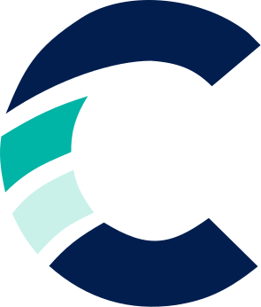

  

# CoLand

**Bring feedback from your team's collaboration tools back to the agent conversation behind the work.**

English · [简体中文](README.zh-CN.md)

[Download](https://www.coland.ai/#download) · [Report a bug](https://github.com/VienLi/CoLand/issues/new?template=bug-report.yml) · [Suggest a feature](https://github.com/VienLi/CoLand/issues/new?template=feature-request.yml) · [FAQ](FAQ.md) · [Articles](articles/README.md)

CoLand connects the places where teams review work with the Agents that help create it. When a colleague comments on a pull request or a document, that feedback can return to the original agent conversation with the context needed to continue the work—saving you from copying comments between tools and explaining them again.

## Where CoLand helps

| In your team's workflow | With CoLand |
| --- | --- |
| A reviewer spots an issue in a pull request. | The feedback returns to the agent conversation responsible for the code. The team can review the resulting changes in the same PR. |
| Several colleagues leave comments on a document. | Feedback reaches the session behind the document, reducing the work of collecting and relaying comments. People continue reviewing the shared document. |

CoLand Desktop supports local **OpenClaw, Codex, Claude Code, and Hermes Agent**, with collaboration integrations for **GitHub, Gitee, GitLab, Feishu, Lark, and Notion**. Check each platform's authorization scope and readiness in the client. The original session must remain accessible, and the Agent acts within its existing permissions; your team still reviews the results and decides what to accept.

Broader integrations and multi-Agent coordination are areas we are exploring. The articles below distinguish those ideas from capabilities available today.

## What this repository is for

This is CoLand's public community home. Use it to report bugs, suggest improvements, ask usage questions, and find answers and product articles. CoLand's application source code is not currently public; this repository contains community materials and feedback.

Before opening an issue, check the [FAQ](FAQ.md) and [existing issues](https://github.com/VienLi/CoLand/issues). You can write in **English or Chinese**. For help getting something working, [ask a usage question](https://github.com/VienLi/CoLand/issues/new?template=usage-question.yml).

We use issues to clarify reports, share progress, and record solutions or the release that addresses a problem. Follow priorities, feature plans, and progress on the public [Feedback & Roadmap board](https://github.com/users/VienLi/projects/2). Planned dates and versions may change. Common answers are added to the FAQ. Account, billing, and other matters requiring private information should go to [support@coland.ai](mailto:support@coland.ai).

## Download and updates

Get the current stable release from the **[official download page](https://www.coland.ai/#download)** and see what changed in the **[release notes](https://www.coland.ai/releases)**.

| Platform | Available packages |
| --- | --- |
| macOS | Apple Silicon (ARM64) and Intel (x64) DMG; macOS 13 or later |
| Linux | x64 AppImage (FUSE 2) and DEB for Debian / Ubuntu |
| Windows | Planned; availability will be announced on the website |

The website is the source for current versions and download availability. Installation packages are distributed there.

## Featured articles

These four articles are also available in Chinese. Read the [article index](articles/README.md) for both editions and their original publication details.

- [About CoLand](articles/en/about-coland.md) — one founder, a team of Agents, and the everyday work that led to CoLand.
- [Product Notes—Judgments About the Future](articles/en/architecture-evolution-prologue.md) — the assumptions guiding CoLand's long-term direction.
- [Product Notes—Giving People Their Attention Back](articles/en/architecture-evolution-feedback.md) — reduce manual feedback forwarding and organize scattered tools, devices, and Agents.
- [Product Notes—Decisions Are the Most Important Asset](articles/en/architecture-evolution-decisions.md) — our next-stage thinking on decision Agents and experience that stays under your control.

## Team and community

CoLand is a small team exploring a one-person company model: one founder working with more than a dozen Agents on research, design, development, and day-to-day operations. We build from the collaboration problems we encounter ourselves and share what we learn along the way.

| Find us | Link |
| --- | --- |
| Website | [coland.ai](https://www.coland.ai/) |
| Community feedback | [GitHub Issues](https://github.com/VienLi/CoLand/issues) |
| Feishu community | [Join the group](https://applink.feishu.cn/client/chat/chatter/add_by_link?link_token=dd7jf3cf-999a-4cd7-b33f-3a89f2c8f722) |
| Discord | [Join the community](https://discord.gg/aw4UDrxdSA) |
| Support | [support@coland.ai](mailto:support@coland.ai) |
| Maintainer | [@VienLi](https://github.com/VienLi) |

Documentation corrections, translation improvements, and useful experiences are welcome. See [Contributing](CONTRIBUTING.md) for how to help.
