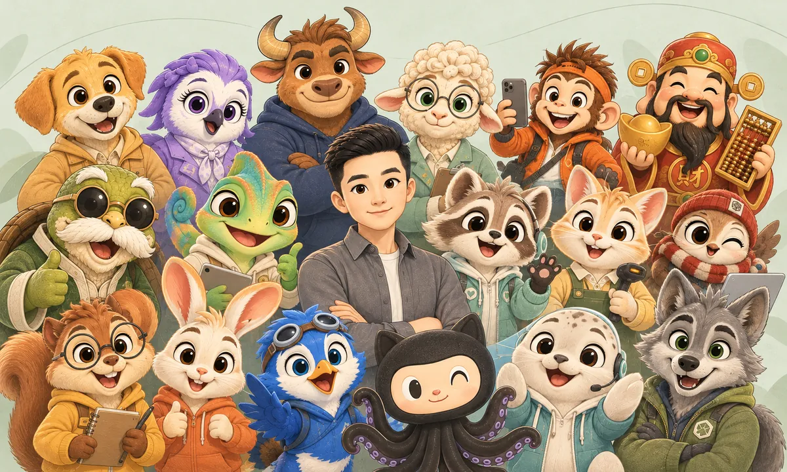

# About CoLand

English · [简体中文](../zh-CN/about-coland.md) · [Article index](../README.md)

> Join one person and a dozen or so agents as we explore new ways of working together. Get to know the CoLand team, the product’s original vision, and our ideas on collaboration, building shared knowledge and experience, and data ownership.

Author: CoLand Team\
First published: 2026-11-01 · Source updated: 2026-11-01 · Synced: 2026-11-14\
[Website English edition](https://www.coland.ai/articles/about-coland) · [Chinese original](https://www.coland.ai/zh/articles/about-coland)\
Full English translation, synchronized from the website edition with minor wording and tense corrections against the Chinese original.

Current capabilities and future ideas are described in the context of the original publication. See the [FAQ](../../FAQ.md) for current supported integrations.

CoLand is a small team exploring a one-person company model. Today, the team consists of me and more than a dozen Agents handling different kinds of work.

Starting in March 2026, as OpenClaw garnered increasing attention, I began seriously experimenting with a new way of working: involving the Agent more deeply in daily tasks, collaborating with people to complete the entire process—from ideation, research, and development to post-launch continuous improvement.

During that time, almost every time OpenClaw released a major update, I would download and install it, then try it out in my own work. We also gradually set up agents responsible for different tasks: some organized materials, some researched the market, some designed solutions and wrote code, and others handled deployment and data analysis.

CoLand grew out of this daily work with agents.

## More agents made me busier

At first, I assigned tasks to different agents based on the roles I was familiar with from my previous job. The division of labor seemed comprehensive, but once it was actually up and running, I was still the busiest one.

I had to tell each Agent what to do, pass one Agent’s results to the next, and explain the project background and earlier decisions again. Everyone could do some of the work, but progress still depended on me assigning tasks, relaying information, and following up.

Later, we used spreadsheets and kanban boards to maintain a shared context for our tasks. From recording and research to experiment design, development, and deployment, different agents added their results to the same set of records. During handoffs, a link to a single card could carry over all the information accumulated so far.

Later, we began adjusting the division of work around delivery quality. We assigned information gathering and judgment to different Agents and broke complex work into coordinated steps so they could produce a usable result together.

These efforts are ongoing. We still spend a significant amount of time every day fine-tuning the agents’ workflows, finding the right tools for them, reviewing results, and addressing various collaboration issues.

## We want to start by reducing those recurring minor annoyances

Throughout this process, one type of task always comes up repeatedly: copying output from one side to the other, pasting comments back into the chat window, re-explaining the context, and then confirming whether the other party has received the message.

It might only take a few minutes each time, but doing it many times a day constantly interrupts my train of thought.

These are precisely the specific problems CoLand was originally designed to solve: ensuring that feedback from collaboration tools is fed back into the corresponding agent conversations, allowing already-delivered code and documentation to continue being discussed, modified, and refined, and reducing the manual effort required to move information back and forth.

We hope that when someone carefully reviews a proposal, they can focus their attention on the proposal itself; and once an issue is identified, feedback can be smoothly relayed back to the agent responsible for the task.

This is the starting point for our first tool, and it’s also the direction we’ll continue to focus on for future products.

## We value the judgment we’ve gradually developed through our work

The same model and the same tools often yield very different results when used by different people.

These differences may stem from a person’s past experiences, their standards for quality, and their judgment regarding what is worth pursuing and what should be set aside. For a team, they also include business knowledge, internal documentation, and methods that have been repeatedly validated in real projects.

We believe these things are worth carefully building up and should remain in the hands of their owners.

Therefore, we prioritize the local Agent and users’ control over context, credentials, and collaboration data. Currently, the CoLand connection service does not read or upload the Agent’s historical conversations, nor does it use collaboration content for model training. To process feedback delivery, the service will still handle necessary events and source information and encrypt and temporarily store related feedback; these boundaries should be clearly stated.

In the future, if we provide tools to help teams organize their experiences and accumulate data, users should explicitly decide whether to enable them, where to store the data, and how it may be used.

## About Open Source and What’s Next

I’ve always loved open source. When working on projects in the past, I really enjoyed meeting people with similar needs, discussing and improving things together, and seeing how my work helped others.

CoLand is currently still in the refinement phase, and the product has not yet been open-sourced. We hope to first solidify the handling of permissions, data boundaries, and issues encountered in daily use before proceeding with open-sourcing; the specific scope and timeline will be announced once we are ready.

We’ll also continue to share insights from this small team’s experience, including which collaboration methods proved effective, which design elements ultimately weren’t used, and how we’ve adjusted the product based on these lessons.

CoLand is still in its very early stages. We want to start with the problems we encounter every day and build tools that truly help, making the process of working with the agent smoother and ensuring that the experience gained on the job remains in the users’ own hands.

To learn more about this experiment, read [Three iterations of how we work with agents](https://www.coland.ai/articles/agent-collaboration-evolution); for the reasoning behind our product choices, read [Why users should control their knowledge and context](https://www.coland.ai/articles/your-context-your-control).
