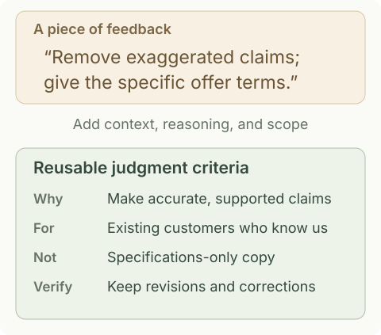
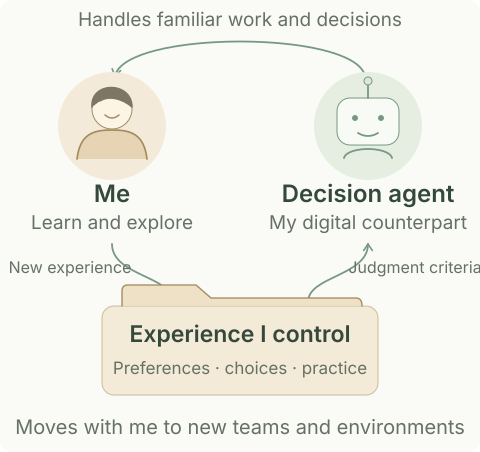
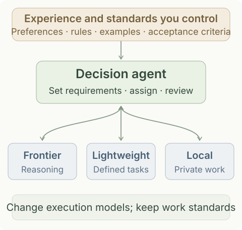

# Product Notes—Decisions Are the Most Important Asset

English · [简体中文](../zh-CN/architecture-evolution-decisions.md) · [Article index](../README.md)

> Build experience from collaboration events, let a decision agent handle familiar judgments, and retain personal and team ways of working when models change.

Author: CoLand Team\
First published: 2026-11-14 · Source updated: 2026-11-14 · Synced: 2026-11-14\
[Website English edition](https://www.coland.ai/articles/architecture-evolution-decisions) · [Chinese original](https://www.coland.ai/zh/articles/architecture-evolution-decisions)\
Full English translation, synchronized from the website edition.

Current capabilities and future ideas are described in the context of the original publication. See the [FAQ](../../FAQ.md) for current supported integrations.

The previous article described CoLand’s current work: reducing manual feedback forwarding and organizing relationships among sources, deliverables, devices, and agents. This removes some coordination steps, but people still need to judge whether a task is done correctly or a proposed change is appropriate.\
When those judgments recur, another question appears: **can requirements a person has explained many times become a basis for future decisions?**

This is our next direction. Building on events and their relationships, we plan to bring personal and team experience into task assignment, result review, and everyday judgment.\
This layer has another purpose: keeping accumulated ways of working in an environment people control. Even when tools or underlying models change, a team should retain the means to guide a new executor and assess it against established standards.

## Preserve the reasoning behind a piece of feedback

Imagine promotional copy for existing customers. An agent writes “Our biggest discount ever,” and the reviewer asks it to replace that phrase with the specific offer terms. If only the final copy survives, it becomes difficult to know why the change happened.\
Keeping the original, comment, revisions, and final approval reveals something more useful: these customers know the product, and the team wants accurate, direct language without unsupported exaggeration.

That experience also has a scope. Which customers and situations does it concern? Why choose that wording? When might the team need to reconsider? Those details determine whether it applies next time.\
Remembering only “never use this phrase” can turn one edit into a universal prohibition. Context and reasoning give a new agent a chance to understand the purpose of the judgment.

We want to gradually organize such collaboration histories into rules and examples. The deliverable is what is judged; comments record requirements; revisions show how they were met; subsequent approval identifies what was accepted. A person’s corrections to the reviewer also belong in the record.\
Events can therefore be a source of experience, but raw records still need selection, interpretation, and checking. A comment appearing once does not automatically make it a reusable rule.

**The next stage should retain judgment with context, reasoning, and room for correction.**\
It may begin as rules, examples, and review records. As validation progresses, we can explore retrieval, review prompts, or model training. What matters is whether the experience improves future delivery; the method should follow the results.

## Make accumulated experience an asset of your own

When we talk about sharing knowledge and experience with AI, “distillation” is not always reassuring. Colleagues have expressed a concern we understand: if a system learns their methods and judgments, will it replace their value within the organization?\
That concern is understandable when the accumulated knowledge remains only with a company, model service, or agent platform and the individual cannot continue to control and use it. We believe a crucial question is who ultimately owns this experience and whom it serves.

Model products already build a long-term understanding of users. [ChatGPT memory](https://openai.com/index/memory-and-new-controls-for-chatgpt/) draws on prior interactions for personalization, and [Claude offers memory import and export](https://support.claude.com/en/articles/12123587-import-and-export-your-memory-from-claude).\
Our judgment is that these capabilities will extend further into how people decide: why someone accepts a proposal, when they change their mind, and which requirements they will not compromise. Understanding these patterns may become a lasting competitive advantage sought by model vendors and personal-agent platforms.

The better an agent understands someone, the more likely it is to become a long-term working partner. If that understanding can exist only within one platform, more accumulated experience also means more to rebuild when moving away.\
We therefore want ownership and portability to be central to the product from the beginning.

**A person’s judgment, preferences, and experience should become assets they control, that work for them, and that can move with them.**\
Over time, these can form a digital counterpart that knows how I approach problems, understands why I accept or reject proposals, and handles repetitive work and decisions under established agreements.

That gives me more attention for knowledge I have yet to acquire, methods I have not tried, and more challenging problems. New experience can then improve my counterpart’s judgment and allow it to handle more familiar work.\
**The person keeps learning and growing; the agent grows with their experience, and both work together on the world around them.** Organized experience continues helping me while I focus on the next exploration.

This asset should accompany a person’s career. When joining another team, changing companies, or starting a business, they should still be able to use the judgment and work experience they have developed.\
It should also work with different models. When switching vendors or choosing a local or domain-specific model, the experience a person controls can help the new executor understand their requirements and reduce the cost of establishing a working relationship again.

Even when work uses external platforms and models, we want users to retain their own copy of experience that they can keep organizing, using, and moving. The next stage of our design centers on this ownership.\
When the result continues to serve its owner, distillation takes on a positive meaning: it helps us carry the capabilities we have gained into what comes next.

We call the digital counterpart that carries this personal experience and participates in work judgments on our behalf a **decision agent**.\
In the design that follows, it uses continually refined judgments, preferences, and practical experience to help assign work, review results, and make familiar decisions. With a new problem, it brings the context back for discussion. Personal experience then has a way to keep working for its owner.

## Let the decision agent assign and review work using that experience

When a person states a goal, the decision agent can combine the requirements, existing experience, and executors’ capabilities to decide who does what, how to divide the work, and which tasks can run in parallel. After delivery, it performs an initial review against the relevant standards.\
Some of the repeated cycle of assigning work, reading results, and explaining changes can move into this layer.

The collaboration relationships from the previous stage remain useful. The decision agent can leave review comments beside code or documents. Those comments return to the original executor through the established link, and the reviewer can inspect the revised version.\
A person can read reports or inspect the collaboration directly on the deliverable: what was submitted, why the reviewer requested a change, and why the final result was accepted.

This visibility matters. Suppose the decision agent interprets “don’t exaggerate an offer” as “all copy must contain only specifications.” A person can correct its comment: promises need evidence, but expressive language is still welcome.\
The correction concerns the review criteria. It should enter the experience being maintained so the next review better reflects what the person actually wants.

**People gradually move from inspecting every deliverable to calibrating review standards, handling exceptions, and checking key outcomes.**\
Whether a decision agent can reliably do this must be tested through repeated delivery. Reducing human review time while maintaining quality are both requirements for this layer.

## Gradually delegate everyday decisions to agents

The human bottleneck appears during execution as well as review. Many tasks already have a known next step but are waiting for a condition to be met or for someone to say “go ahead” again.\
When the conditions and authorization are clear, a decision agent can use a new event to decide whether work can resume.

For example, a proposal is waiting for missing information from a customer. When it arrives, the system links it to the original task. The decision agent checks that the missing information is complete and lets the original executor continue. A person does not have to open another conversation just to say “the information is here.”\
If the customer also introduces a new request outside the agreement, the goal or scope needs reconsideration. The decision agent can organize the change and its implications before bringing it to the responsible person.

This is also why we are extending collaboration events to email, calendars, and other notifications. The first stage brings messages into the work environment. The next decides which changes matter, which allow work to continue under existing agreements, and which require human involvement.\
When a person decides how to handle a new situation, the decision and its applicable conditions can become a basis for the next similar case.

**We want people to focus on problems for which experience has not yet formed, while agents gradually take on established approaches within their authorization.**\
This connects to the opening article’s judgment about the share of everyday decisions delegated to agents. Trust develops as results are accepted and mistakes corrected. People can review completed actions and pending questions at a pace that works for them.

## Keep work standards in the decision agent

Combining models at different prices and changing models, devices, or execution tools share one premise: **retain accumulated experience and requirements in the decision-agent layer, so execution can change while work standards continue.**\
In our design, preferences, judgment examples, business processes, and acceptance criteria remain in an environment the user controls. The decision agent continually organizes and uses them to explain requirements, select executors, and review delivery.

Model choice can then follow the task. A stronger model can reason through a complex plan, while clear, well-defined parts go to a cheaper or local model.\
Whichever model performs the work, the decision agent supplies the relevant context and constraints, then reviews the result against the same requirements. A model’s price and capability determine suitable assignments; accumulated personal and team standards determine whether the result is acceptable.

The same approach applies when changing models or moving the work environment. A new executor receives organized preferences, rules, and examples. The decision agent continues requesting changes and checking outcomes against those requirements, helping the executor understand established ways of working.\
We want users to retain, revise, and move their experience, carrying requirements and processes into a new execution tool with less explanation and adjustment from scratch.

**The executor changes; the owner’s judgment criteria and requirements for results remain.**\
That also defines how we assess this design. Whether using a cheaper model or moving to a local environment, real tasks must show whether established standards are maintained. The comparison must include the full cost of decision-making, execution, and revision.

## Protect your value while working with AI

The two stages now connect back to the opening article. First, reduce coordination work and organize a complex environment and its collaboration events. Then extract useful experience from those events, delegate some judgments, and allow that experience to move between execution tools.

We will test this direction with real tasks. How often must the responsible person intervene in similar work? Does delivery meet confirmed standards? After switching to a cheaper or privately deployed model, how much must be explained or corrected again?\
Those results tell us whether accumulated experience is useful, whether the decision layer reduces the human burden, and whether the chosen model combination is worth pursuing.

As AI develops rapidly, we can feel the anxiety many people have: when more work can be handed to AI, how can their experience and judgment remain a source of their own value? That concern is an important reason we are building this tool.

Choosing this direction may put us in competition with platforms over the same layer of value: a long-term understanding of how users decide. If a business model depends on keeping that experience within one platform, the portability we advocate may conflict with its interests.\
Our position is that this understanding should ultimately become a capability the user controls, preserving choice as tools and models change.

The challenges are concrete. We must keep adapting to different platforms, organize scattered feedback into usable judgment criteria, and verify that experience remains useful after a model change. Every integration and migration requires maintenance and validation.\
We hope users will pay for smoother collaboration, personal experience that remains useful over time, and the freedom to choose. That support allows us to keep building and maintaining these capabilities.

**We want to help everyone make full use of AI, collaborate with it, and protect and develop their own value along the way.**\
Knowledge, experience, preferences, and judgment should remain under their owner’s control—as capabilities they can carry forward and develop. We want every collaboration with AI to give people more room to learn, create, and choose their direction.

Back to the opening article: [Product Notes—Judgments About the Future](architecture-evolution-prologue.md)
