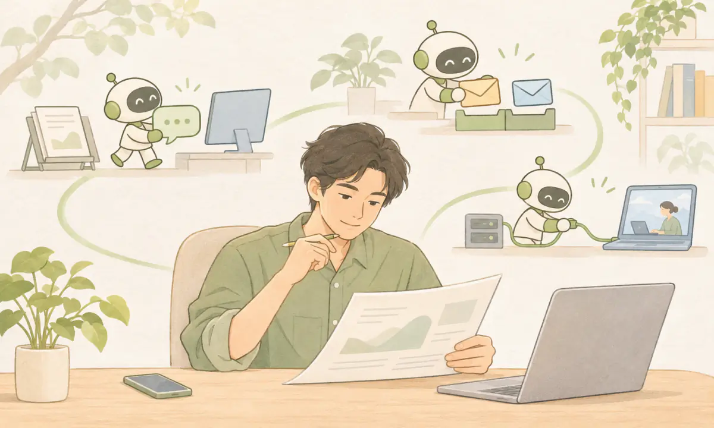
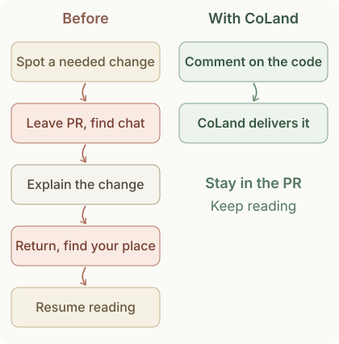
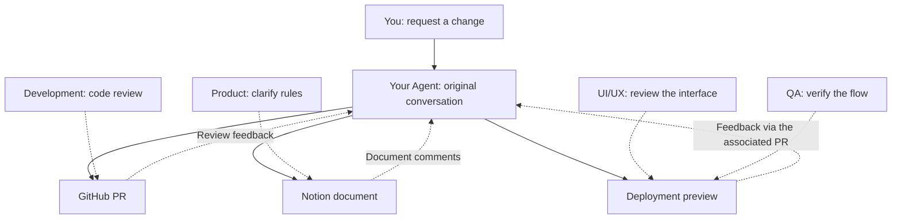
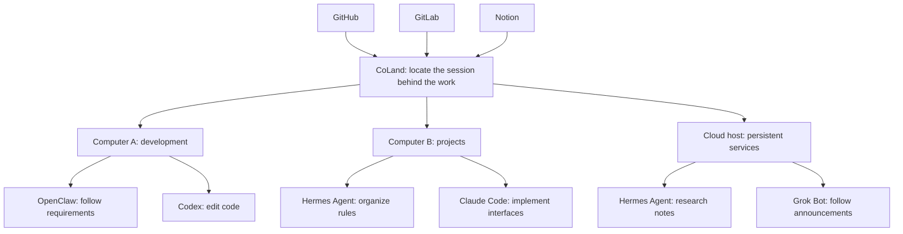
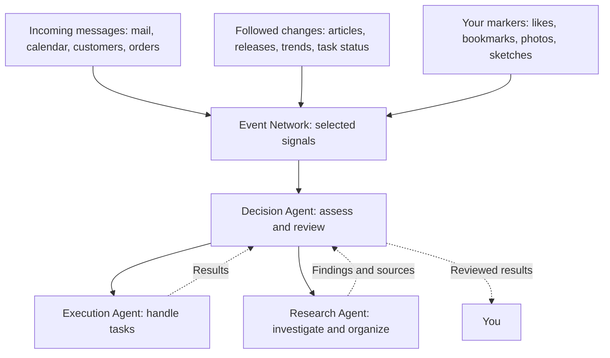

# Product Notes—Giving People Their Attention Back

English · [简体中文](../zh-CN/architecture-evolution-feedback.md) · [Article index](../README.md)

> CoLand’s current focus is to reduce feedback forwarding and repeated context switches, and organize scattered platforms, devices, and agents.

Author: CoLand Team\
First published: 2026-11-14 · Source updated: 2026-11-14 · Synced: 2026-11-14\
[Website English edition](https://www.coland.ai/articles/architecture-evolution-feedback) · [Chinese original](https://www.coland.ai/zh/articles/architecture-evolution-feedback)\
Full English translation, synchronized from the website edition.

Current capabilities and future ideas are described in the context of the original publication. See the [FAQ](../../FAQ.md) for current supported integrations.

The previous article set out several connected judgments: agents will handle more work, personal and organizational AI environments will grow more complex, and human time and attention will limit parallel work.\
That determines CoLand’s current focus: **reduce the coordination needed to keep work moving, so people can keep their attention on results and important judgments.**

There are two parts to this work. One sits within collaboration: finding conversations, forwarding comments, supplying context, and tracking responses. The other sits within the work environment: messages from different platforms, agents on different devices, and their relationships to specific tasks.\
Our current product starts with those two parts, gradually transferring relationships that people have had to remember and maintain into the system.

Following the same goal, we are also designing an extension: organizing reading, learning, and notifications outside work, so external information can enter a person’s knowledge and workflow more easily. We call this the Event Network, discussed below.

## More parallel work also creates more coordination work

One agent changes code, another drafts a proposal, and a third organizes research. They can work simultaneously, but feedback on their deliverables may arrive separately in GitHub, documents, and other platforms.\
A person must identify the task behind each comment, then find the responsible agent, conversation, and device. Even a clearly written comment often has to be turned into another instruction before the agent can continue.

Each action seems small on its own. Its real cost comes from interrupting work that needs continuous thought.\
While reading a design proposal, I notice something that does not make sense. Instead of simply commenting on the paragraph, I leave the document, open a conversation list, identify the task, and send the feedback. When I return, I have to find where I stopped and recover what I was thinking about.

The later feedback arrives, the harder this becomes. Someone reviews a document written several days ago; several similar proposals created on one day are difficult to distinguish by conversation titles alone. More tasks mean more relationships for a person to remember.\
**At these points, a judgment already made still needs someone to carry it elsewhere. That is the work we want to remove first.**

## Leave feedback where you see the result

Code review is a straightforward example. In GitHub, I see code that deletes a shared project without asking the user to confirm. I comment at that location: “Ask the user to confirm before deleting.”\
The comment already explains what needs changing. I want to keep reviewing while the responsible agent handles it.

CoLand starts by linking a deliverable to its original conversation. In supported workflows, when an agent creates or takes responsibility for a deliverable, the system records the agent, device, and conversation responsible for it. Feedback on that deliverable can then follow the relationship back to the original execution context.\
People do not need to answer “Who made this?” or “Which window should I open?” again. The code location, comment, and associated deliverable enter the original conversation, where the agent can continue with the existing context.

The original conversation matters because the earlier discussion is still there: why we chose this implementation, which constraints were confirmed, and which alternatives were rejected. All of that may be needed for the next change.\
CoLand preserves the relationship and delivers feedback; the original agent still performs the work. After the change, people review it in the same PR or document. Feedback delivered, work started, and the result correctly updated are different states that need to remain distinguishable.

**People keep reading, judging, and accepting results; the system locates and forwards the feedback.**\
That is where returning feedback to the original conversation fits into the product: it is one way to reduce attention switching.

## Team collaboration should not depend on one person relaying messages

The same problem appears in teams. I work with an agent on a campaign plan and send it to a manager. The manager cares about prizes and budget, without needing to know which local agent I used.\
If the manager comments “Cut the prize budget in half,” I previously had to notice the comment, find the original conversation, and relay it. That interrupts my attention, and the change waits until I am available.

With several participants, forwarding becomes an exercise in collecting opinions. One colleague proposes a change, another supplies context, and a manager confirms the final approach. Someone must participate in the discussion and then assemble the scattered information for the executor.\
We want the discussion to remain beside the deliverable. Its comments, replies, and confirmed conclusions should follow the established relationship into the responsible conversation. The executor can see the source and location of feedback, while collaborators can inspect the changes where they already work.

Human judgment is still needed. Conflicting comments often require a choice based on the team’s goals. The responsible person can state the conclusion in the discussion, and the system delivers it.\
**We want to reduce the work of collecting, copying, and relaying opinions, so people can focus on the discussion itself.**

The same division applies when collaboration extends to customers, external partners, and open-source contributors. They can use familiar platforms without joining our agent tools or understanding the execution environment behind them.

**Feedback follows the work back to the original session**

[GitHub diagram adaptation; view the website original](https://www.coland.ai/articles/architecture-evolution-feedback#team-collaboration-should-not-depend-on-one-person-relaying-messages)

## Organize a scattered work environment

As agents multiply, the problem expands from a few chat windows to an entire work environment. Coding may happen on one computer and research on another. Some tasks use local models; others call remote services. Deliverables live in repositories, document systems, and spreadsheets.\
Users need to maintain more than a tool list. They need to know which agent on which device is responsible for which work. That relationship determines where a new notification should go.

CoLand’s current development therefore centers on four kinds of objects: collaboration sources, devices, agents, and deliverables. Changes from different sources can enter a shared management system as events, then follow the deliverable relationship to the right execution environment.\
A GitHub comment and a document comment have different content, but both need a source, location, associated deliverable, and processing status. Events connect that scattered information and reduce the need to inspect and interpret each platform separately.

**An example of routing feedback across devices and Agents**

[GitHub diagram adaptation; view the website original](https://www.coland.ai/articles/architecture-evolution-feedback#organize-a-scattered-work-environment)

This explains why we are connecting more collaboration platforms while expanding agent support. Connecting only message sources still leaves a person to forward them to executors. Connecting only agents leaves them disconnected from external collaboration. One system needs to maintain the relationship between both sides.\
Within the supported scope, users can inspect connections and event records to understand whether feedback arrived, which environment should receive it, and whether anything needs attention. Progress becomes visible through a shared entry point.

The current version is building and expanding these connections and relationships. More devices, notification sources, and agents will join through the same approach. We want an environment that can keep expanding without management effort growing at the same rate as tools and devices.

## Organize external information too

Work collaboration is only one source of interruption. When I find a research paper worth studying, I may leave the website, find my research agent, and explain the link and my questions again. After watching an interview, I need to extract the useful ideas and discuss their relevance to my work with AI.\
The information is valuable, but turning it into usable knowledge still takes collection, filtering, organization, and forwarding.

**The Event Network is a part we are designing and preparing to launch: connecting external information with personal knowledge, tasks, and agents, so it can be organized before it asks for a person’s attention.**\
An entry point could be a deliberately shared paper or video, or a bookmark, email, or application notification where platform integrations permit it. We want people to hand content to the right agent where they discover it, continuing existing research or work.

A 40- or 50-minute interview might contain only a few ideas worth further study. Other parts may be familiar or already put into practice. A chronological summary still leaves me to filter them again.\
We envision AI using the knowledge, discussions, and practice records a user has saved to identify repetition, then retain new insights, disagreements with existing judgments, and approaches still worth testing. Sources and key excerpts should remain available for follow-up and review.

The organized material can also suit the person’s learning style. A complex idea can become a diagram, a method can become a presentation, and differences between approaches can become a visual comparison.\
The result is material better suited to understanding and discussion. Our goal is to turn prolonged watching and filtering into focused reading about what is new.

Bookmarks can also start a learning process. Where bookmark signals are available, one action could trigger background analysis: what the content says, which current task it relates to, and whether it suggests an improvement worth trying.\
After discovering a new user-interview method, for example, AI could connect it to an ongoing study, explain how it differs from the current approach, and suggest a small experiment. Through discussion and practice, the user can decide what belongs in their knowledge base. External information has a path into actual work instead of stopping at a bookmark list.

Email and routine notifications can follow the same pattern. AI first identifies the related task. Matters covered by existing agreements and authorization can go to the appropriate executor; those needing new judgment can reach a person with context and implications already organized.\
This design will work with the next stage of decision-making capabilities, gradually reducing switches made only to inspect, identify, and relay messages.

**Event Network concept: organize selected signals before acting**

[GitHub diagram adaptation; view the website original](https://www.coland.ai/articles/architecture-evolution-feedback#organize-external-information-too)

**We want people to devote more attention to the unfamiliar, to disagreements, and to practice, while the system handles repeated filtering and forwarding.**\
Collaboration at work and reading, learning, and notifications outside it all draw on the same limited attention. The Event Network explores how to organize those external demands too.

## Make collaboration work, then build on the judgments it leaves behind

At this stage, we start by reducing feedback forwarding and repeated switching: leave instructions beside the result, remove the need for one person to relay team discussions, and organize scattered platforms, devices, and agents. Each approach reduces coordination effort and helps reading and thinking stay continuous.

Reading, learning, and notifications outside work also compete for attention. The Event Network will extend our work in that direction. But after collecting the information, deciding what matters, what existing experience can handle, and what requires a fresh judgment will still need agents that understand us better.

The next step is to study how a decision agent can better understand our requirements, gradually handle familiar judgments, and return new questions worth learning about and discussing. **The shared goal is to concentrate limited attention on new, important things.**

Next: [Product Notes—Decisions Are the Most Important Asset](architecture-evolution-decisions.md). We will explore how experience recorded through collaboration can inform decisions, remain under our control, and continue working for us.
