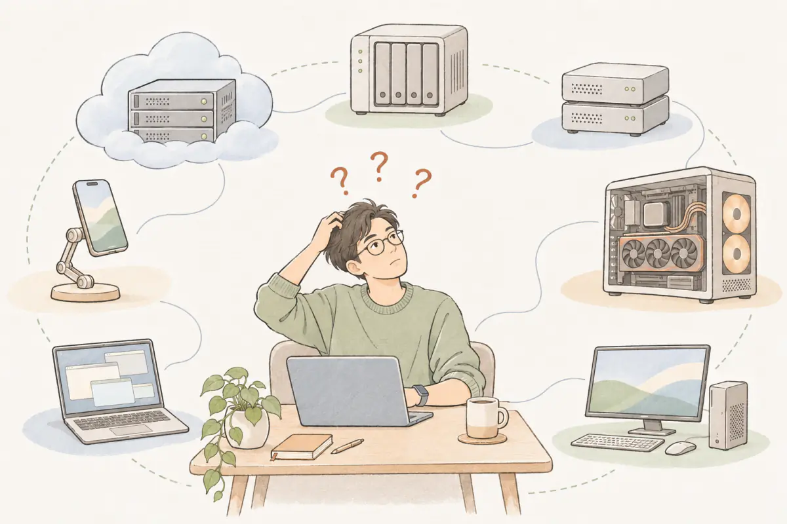
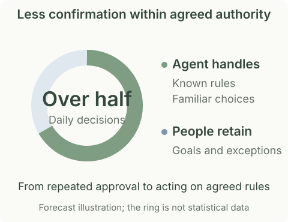
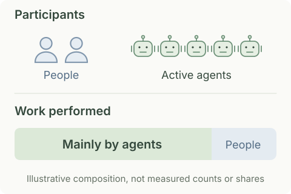
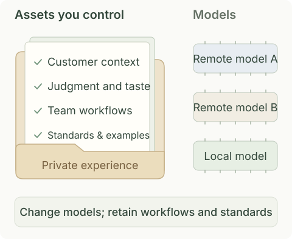

# Product Notes—Judgments About the Future

English · [简体中文](../zh-CN/architecture-evolution-prologue.md) · [Article index](../README.md)

> Begin with the end in mind: define a product’s long-term goals through a view of the future.

Author: CoLand Team\
First published: 2026-11-14 · Source updated: 2026-11-14 · Synced: 2026-11-14\
[Website English edition](https://www.coland.ai/articles/architecture-evolution-prologue) · [Chinese original](https://www.coland.ai/zh/articles/architecture-evolution-prologue)\
Full English translation, synchronized from the website edition.

Current capabilities and future ideas are described in the context of the original publication. See the [FAQ](../../FAQ.md) for current supported integrations.

One way to build a product is to start with a need that already exists and solve a concrete problem. Another is to look further ahead: form a view of where an industry is going, then consider the problems people will encounter and the tools they will need.\
CoLand follows the second approach.

Today, its capabilities are still modest. It is difficult to point to a vast audience or a problem everyone urgently wants solved. We keep investing because we believe some needs will become more important as models, agents, and ways of working change. This series records those judgments and the product decisions that follow from them.\
This opening article sets out assumptions about November 2027: what might change, and what problems might arise. We want those longer-term assumptions to guide the product and its features. The following articles explore the design.

## The most capable models will cost more

In November 2025, Anthropic released Opus 4.5 at standard API prices of $5 per million input tokens and $25 per million output tokens. In November 2026, it introduced Fable 5.2 for more demanding tasks, priced at $8 and $40 respectively. Comparing the same billing units, both input and output prices rose by 60% between these frontier offerings.\
At the same time, Fable 5.2 costs less than the preceding 5.1 generation in its product line. Vendors are reducing the cost of established capabilities while setting new price tiers for greater capability. [Opus 4.5 announcement](https://www.anthropic.com/news/claude-opus-4-5) · [Fable 5.2 pricing and evaluations](https://www.anthropic.com/claude-fable-and-mythos-5-2)

The infrastructure investment behind these capabilities is also growing quickly. Anthropic reported compute and infrastructure spending of $18.808 billion in the first nine months of 2026, compared with $4.381 billion a year earlier. In its fiscal fourth-quarter 2026 remarks, Micron reported that DRAM prices rose nearly 20% sequentially and anticipated tighter memory and storage supply in 2027 and 2028. Larger models, longer contexts, and greater concurrency also increase memory requirements. [Anthropic registration filing](https://www.sec.gov/Archives/edgar/data/2130357/000162828026072484/anthropicpbc-sx1ax2.htm) · [Micron earnings remarks](https://s25.q4cdn.com/621799436/files/doc_financials/2026/q4/Q4-FY26-Prepared-Remarks.pdf)

Electricity faces similar pressure. US Energy Information Administration data shows that the average commercial electricity price in August 2026 was 4.3% higher than a year earlier. The International Energy Agency describes data centers competing for power, grid connections, and chips, with more complex reasoning and agent tasks adding to energy use per task.\
How power prices, memory prices, and total investment feed into model pricing depends on efficiency gains, supply contracts, and competition. Our inference is that the cost pressure behind continuously delivering frontier capabilities will remain substantial. [US commercial electricity data](https://www.eia.gov/electricity/monthly/update/end-use.php) · [IEA analysis of AI energy and supply constraints](https://www.iea.org/reports/key-questions-on-energy-and-ai/executive-summary)

For a task such as turning meeting notes into a clear summary, we should also have increasingly affordable options. Stanford’s AI Index reports that inference costs at GPT-3.5-level benchmark performance fell more than 280-fold between November 2022 and October 2024. Technical and deployment improvements can make established capabilities widely accessible. [Stanford AI Index](https://hai.stanford.edu/ai-index/2025-ai-index-report)\
**Our judgment is that matching today’s output quality will become cheaper, while consistently using the most capable models available at the time may require a larger budget.**\
As these models run longer and handle more work in parallel, users will look more closely at how much useful output each unit of spending buys.

## Demand for private deployment will extend from enterprises to individual power users

Enterprises have long needed private deployments. Customer information, internal knowledge, business processes, accumulated experience, and judgment criteria are assets they want to control.\
They also need to protect customer data and business privacy. When using an external model service, the choice depends on which data can leave their environment, where it is processed and stored, and who can access it.\
These concerns give enterprises reasons to keep some data and processing in their own environments. Rising frontier-model costs add another incentive to assess which tasks warrant the strongest model and which can run on a model they deploy themselves.

Open-weight models are lowering the deployment barrier. For example, gpt-oss-20b can run on a device with 16 GB of memory. A decision to self-host can compare the total cost of similar tasks, including hardware, maintenance, and actual usage. [Open-weight model requirements](https://openai.com/index/introducing-gpt-oss/)

We also see some individual power users building their own AI work environments. Starting with a dedicated device for OpenClaw, they may add phones, hardware to control mobile devices, spare computers, and NAS storage, gradually expanding their tools, components, and devices.\
Software foundations for this already exist. OpenClaw supports macOS, iOS, Android, and other devices as nodes, allowing agents to use the capabilities of different devices. [OpenClaw device nodes](https://docs.openclaw.ai/nodes)

Local compute options are expanding too. NVIDIA DGX Spark offers 128 GB of unified memory and supports directly connecting two units. Mac Studio offers 256 GB and 512 GB unified-memory configurations. Individuals can build local model environments with this hardware and combine them with storage, mobile devices, and remote services. [DGX Spark](https://www.nvidia.com/en-us/products/workstations/dgx-spark/) · [Mac Studio specifications](https://www.apple.com/mac-studio/specs/)\
What we see among these users is an increasingly complex personal AI environment, spanning models, agents, devices, and the ways they work together.

People familiar with multiple agents also accumulate workflows, skills, professional resources, and preferences. Hermes Agent already supports self-hosting, multiple model providers, skills, and long-term memory, allowing experience to stay within an environment maintained by the individual. [Hermes Agent](https://github.com/NousResearch/hermes-agent)\
Together with devices, compute, and storage, these resources form an AI work environment spanning operating systems, local machines, and cloud services.\
Organizing that environment becomes a new problem: helping agents find the right device, use the tools and information they need, and keep the whole system working efficiently. Protecting, maintaining, and migrating assets must be considered within that wider environment.

Private deployment can begin with part of the work. Knowledge and rules stay under the user’s control; approved context can go to a remote frontier model for complex decisions. Once a plan is clear, a local model can handle execution suited to its capabilities. Microsoft’s developer documentation also describes combining local and cloud AI as a deployment approach. [Microsoft on hybrid deployment](https://learn.microsoft.com/en-us/windows/ai/cloud-ai)

**We expect demand for private deployment from both enterprises and individual power users, with combinations of local and remote models becoming more common.**\
Controlling work materials and the agent environment also creates a foundation for changing models, adjusting costs, and reallocating tasks later.

## People are the bottleneck in parallel work with multiple agents

After subscribing to a stronger model or investing in hardware for a local one, people naturally want it to do more useful work. But after buying more execution capacity, we may find that our own time is the hardest resource to increase.\
Agents can write code, organize research, and draft proposals in parallel. A person still has to review each result, think through key choices, and send feedback. A gap emerges between how many tasks someone can start and how many results they can thoughtfully handle.

In practice, the limit often appears before work starts. We can configure many agents, but deciding who does what, in which order, and when to begin still requires a person to arrange and activate them.\
One agent may handle code and another documentation. Even with both configured, someone may need to explain the coding task, then open a separate conversation to describe the documentation requirements. The number configured can be large; the number actually working at once depends on how much a person can assign and follow up on.

DeepSeek’s Super-agent design document makes delivering value while consuming as little human attention as possible a central principle. It calls for assessing the attention spent on messages, notifications, and questions. This matches our observation: with more agents, each request for an answer and each interruption can hold up parallel work. [DeepSeek Super-agent design principles](https://github.com/deepseek-ai/dsh-superagent-prototype/blob/main/docs/000-philosophy.md)

Anthropic’s research on Claude Code also found that, on the most complex tasks, agents asked for clarification more than twice as often as people interrupted them. More execution capacity does not automatically remove the steps that require human judgment. [Anthropic on agent autonomy](https://www.anthropic.com/research/measuring-agent-autonomy)\
**We expect human review, decision-making, and focused time to become the main constraints on parallel scale as more agents work simultaneously.**\
Moving from working with three agents to coordinating 30 or 300 increasingly requires solving problems on the human side. Reducing repeated explanations and consolidating feedback so people can devote sustained attention to important judgments will become a practical need.

## Agents will make more than half of an individual’s everyday decisions

Relieving the human bottleneck means gradually delegating some decisions that currently wait for confirmation. The easiest place to start is with decisions I have made many times and consistently resolved the same way.\
After a task in Codex, the input sometimes suggests what I might ask next. Some suggestions follow my existing train of thought: after changing a piece of logic, add the relevant tests. Today, I still read the suggestion and send it.\
If it gets that step right repeatedly, I have a reason to delegate it. Next time it changes the code, it can add tests directly, saving another round of confirmation.

Anthropic saw a similar change in internal Claude Code usage. From August to December 2025, average human interventions per session fell from 5.4 to 3.3. An intervention can involve supplying information or correcting an action.\
At least for those coding tasks, the figures suggest that users could delegate longer stretches of work. [Anthropic’s agent autonomy research](https://www.anthropic.com/research/measuring-agent-autonomy)

How much price variation to accept when buying familiar supplies, whether an expense meets an established rule, or whether a PR needs tests before approval: these everyday decisions have reusable precedents.\
**I expect that, by this time next year, agents may directly make more than half of the recordable daily purchasing, approval, review, and similar decisions for regular AI users, within their authorization. The number of human–AI exchanges needed to reach similar goals should also fall.**\
These can be measured separately. If an agent recommends an action and I approve it, that is my decision. If it acts directly under rules I previously set, that is its decision. Multiple tool calls for the same matter still count as one decision.

## Agents will substantially outnumber people and perform a larger share of teams’ work

When individuals can delegate longer stretches of work and more daily decisions, teams can involve more agents in ongoing operations. Microsoft’s 2026 Work Trend Index reports that monthly active agents in the Microsoft 365 ecosystem grew fifteenfold between March 2025 and March 2026. This is growth on one platform, but it indicates that teams are configuring agents for more work. [Microsoft’s report and methodology](https://www.microsoft.com/en-us/worklab/work-trend-index/agents-human-agency-and-the-opportunity-for-every-organization)

Major vendors are also bringing agents into existing work environments. Microsoft offers Researcher and Analyst in Microsoft 365 Copilot; Tencent has introduced WorkBuddy and its enterprise edition. Users can start with familiar office tools and gradually delegate research, analysis, and routine deliverables. [Microsoft’s research and analysis agents](https://www.microsoft.com/en-us/copilot/blog/2025/03/25/introducing-researcher-and-analyst-in-microsoft-365-copilot/) · [Tencent’s workplace agent](https://www.tencent.com/en-us/articles/2202350.html)

Open-source projects contribute another change. Hermes Agent provides tools, skills, memory, and access to multiple models. DeepSeek has published a Super-agent research prototype. Developers can connect business tools, configure responsibilities, and build clients suited to their teams.\
Alongside the models, runtime frameworks that preserve context, call tools, manage tasks, and receive feedback are maturing. This makes custom agents easier to build and helps them enter more specific workflows. [Hermes Agent](https://github.com/NousResearch/hermes-agent) · [DeepSeek Super-agent prototype](https://github.com/deepseek-ai/dsh-superagent-prototype)

A coding agent can take ongoing responsibility for changes in a repository. An agent connected to a document system can organize information and draft proposals. As capabilities, tools, and runtimes improve together, the range of work that teams can reliably delegate should expand.\
We therefore expect having an agent for each person to become a baseline in organizations that adopt AI early. Individuals will then configure several agents for different responsibilities, alongside agents shared by the team.\
**By this time next year, in those organizations, agents may substantially exceed people both in the number of active participants and in the share of tasks where they perform the main execution work.**\
These are two distinct measures: how many agents and people participate consistently, and how many tasks are primarily executed by each. The first excludes idle configurations; the second measures actual delivery. Installation counts alone cannot establish either conclusion.

## Distinctive judgment will become a portable asset for people and organizations

If most of an organization’s execution is handled by agents and only a few people participate, where does human and organizational value reside?\
The same model can design a product introduction page for different people, but the result that satisfies each person depends on their judgment.

An engineer wants capabilities, technical details, and limitations explained clearly.\
An advertising specialist wants target customers to understand the product’s value immediately.\
A growth practitioner draws on user feedback to decide which scenario to show first and where to invite a trial.\
The model can implement these different approaches. Choosing between them, making trade-offs, and understanding why an approach suits particular customers come from experience, taste, and business understanding.

Some of that experience lives in the understanding formed through long collaboration. A customer dislikes exaggerated promises. A group of users often misunderstands a particular phrase. A team has tried a technical approach and learned when to avoid it. Such judgments are difficult to obtain from public information alone.\
When we repeatedly tell an agent “don’t write it that way” or “don’t omit this step,” we are expressing requirements about customers, teams, and results. The reasons behind those constraints, and the situations where they apply, deserve to be kept alongside the final work.

These differences are worth deliberately retaining. In a short-story experiment, writers given AI-generated ideas produced stories rated as more creative on average, but their stories also became more similar to one another.\
The finding suggests to us that individual judgment matters more when people use similar models. Given the same brief, one person starts with interaction design, another validates the technical approach, and another insists on observing customers at work. The alternatives someone tried, and why they rejected an apparently good option, can reveal more about their taste and judgment than the final design alone. [Doshi and Hauser’s writing experiment](https://pmc.ncbi.nlm.nih.gov/articles/PMC11244532/)

That understanding develops through collaboration and feedback. Copying a few preferences to a new model does not mean it understands the person or their customers. Preserving context, attempted approaches, feedback, and trade-offs—and testing them through subsequent delivery—gives experience a chance to remain useful.

For enterprises, this also needs to extend across business processes. Changes in costs, permissions, or product policies may require a different model or a move to local deployment. The enterprise needs to control how work is assigned, which outcomes are acceptable, and what commitments exist with customers.\
The migration goal is for workflows to keep operating and deliverables to meet established quality standards after the underlying model changes. Work rules, customer context, acceptance criteria, and representative examples should be portable, with real tasks used to assess the new model.

**We expect distinctive judgment, private experience, and workflows that can move between models to become more important assets for people and organizations.**\
When agents perform most execution, these accumulated differences determine whom they serve, which standards they follow, and what they ultimately deliver.

## Designing CoLand from these judgments

These observations inform CoLand’s direction. Changes in model costs, private deployment, and agent numbers will affect how people organize work and create new coordination needs.\
The next two articles cover two stages: how CoLand currently reduces coordination work and organizes complex agent environments, and how a later stage can turn collaboration events into judgment, delegate decisions, and help experience survive model changes.

We will revisit these judgments after three and six months, comparing them with industry developments to assess whether the product direction needs to change.

Next: [Product Notes—Giving People Their Attention Back](architecture-evolution-feedback.md)
