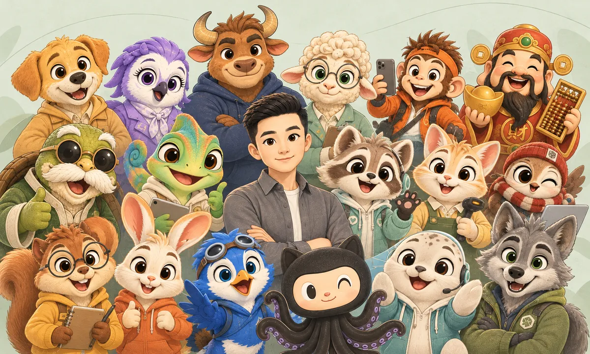

# 关于 CoLand

[English](../en/about-coland.md) · 简体中文 · [文章索引](../README.zh-CN.md)

> 一个人和十几个 Agent，一起探索新的工作方式。认识 CoLand 的团队、产品初衷，以及我们对协作、经验积累和数据归属的想法。

作者：CoLand 团队\
首次发布：2026-11-01 · 原文更新：2026-11-01 · 同步日期：2026-11-14\
[官网中文原文](https://www.coland.ai/zh/articles/about-coland) · 本文为官网原文的同步副本。

文章中的现状与设想以原文时间背景为准；当前支持范围见[FAQ](../../FAQ.zh-CN.md)。

CoLand 是一个正在实践 One Person Company，也就是“一人公司”的小团队。目前，这个团队由我和十几个承担不同工作的 Agent 组成。

从 2026 年 3 月开始，随着 OpenClaw 受到越来越多关注，我开始认真尝试一种新的工作方式：让 Agent 更深入地参与日常工作，和人一起完成从想法、调研、开发到上线后的持续改进。

那段时间，几乎每次 OpenClaw 有大的版本更新，我都会下载、安装，再放进自己的工作里试一试。我们也陆续建立了负责不同事情的 Agent：有的整理资料，有的研究市场，有的设计方案、编写代码，还有的负责部署和数据分析。

CoLand 的产品，就是从这些每天都在发生的协作里长出来的。

## 我们也经历过“Agent 越多，人越忙”

刚开始，我按照过去在公司里熟悉的岗位，把工作分给不同的 Agent。分工看起来很完整，但真正运转起来，最忙的人还是我。

我需要告诉每个 Agent 该做什么，把上一个 Agent 的结果交给下一个，再把项目的背景和前面的决定解释一遍。大家都能做一些事情，但工作往前走，依然依赖我不断安排、传递和追问。

后来，我们用表格和看板保存共同的任务背景。一个想法从记录、调研，到实验设计、开发和部署，不同 Agent 把自己的结果补充到同一套记录里。交接时，一张卡片的链接就能带上此前积累的信息。

再往后，我们开始围绕交付质量调整分工。信息收集和判断交给不同的 Agent，复杂工作拆成几个相互配合的环节，让它们共同完成一份可用的结果。

这些尝试还在继续。我们每天仍然会花很多时间调整 Agent 的工作方法，为它们寻找合适的工具，检查结果，以及处理协作中的各种问题。

## 我们想先减少那些反复发生的小麻烦

在这个过程中，有一类工作总会重复出现：把这边的输出搬到另一边，把评论复制回聊天窗口，重新解释前情，再确认对方有没有收到。

每次可能只花几分钟，一天做很多次，就会不断打断手头的思考。

CoLand 最初想解决的，就是这些具体的问题。让协作工具里的反馈能够回到相应的 Agent 会话，让已经交付的代码和文档可以继续被讨论、修改和完善，减少人来回搬运信息的工作。

我们希望，一个人认真审阅方案时，可以把注意力放在方案上；发现问题之后，意见能够顺畅地回到负责这项工作的 Agent 那里。

这是我们第一款工具的出发点，也是后续产品会继续关注的方向。

## 我们珍惜工作中慢慢积累的判断

同样的模型、同样的工具，交给不同的人使用，结果往往很不一样。

其中的差异，可能来自一个人过去的经验、对质量的要求，以及他判断什么值得做、什么应该放弃的方式。对团队来说，还包括业务知识、内部资料，以及在真实项目里反复验证过的方法。

我们认为，这些东西值得被认真积累，也应当由它们的拥有者掌握。

因此，我们重视本地 Agent，以及用户对上下文、凭证和协作数据的控制。当前 CoLand 连接服务不读取或上传 Agent 的历史对话，也不把协作内容用于模型训练。为完成反馈投递，服务仍会处理必要的事件和来源信息，并加密暂存相关反馈；这些边界应该被清楚说明。

未来如果我们提供帮助团队整理经验、积累数据的工具，也应当由用户明确决定是否启用、保存在哪里，以及允许怎样使用。

## 关于开源，以及接下来要做的事

我一直喜欢开源。过去做项目时，能够遇到有相同需求的人，一起讨论、改进，再看到自己的工作帮助到别人，是很让我享受的事情。

CoLand 当前还处于打磨阶段，产品暂未开源。我们希望先把权限、数据边界和日常使用中的问题处理得更扎实，再推进开源，具体范围和时间会在准备好后说明。

我们也会继续分享这支小团队的实践，包括哪些协作方式确实有效，哪些设计最后没有用起来，以及我们如何根据这些经验调整产品。

CoLand 还在很早的阶段。我们想从自己每天遇到的问题出发，做一些能够真正帮上忙的工具，让人与 Agent 一起工作的过程更顺畅，也让工作中积累的经验留在用户自己手里。

关于这段实践，可以继续阅读[我们与 Agent 协作的三次迭代](https://www.coland.ai/zh/articles/agent-collaboration-evolution)；关于产品选择，可以阅读[为什么我们坚持让工作经验和上下文由用户掌握](https://www.coland.ai/zh/articles/your-context-your-control)。
