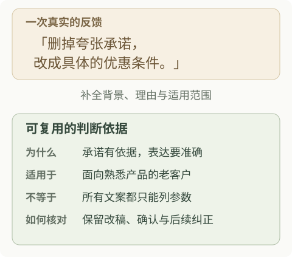
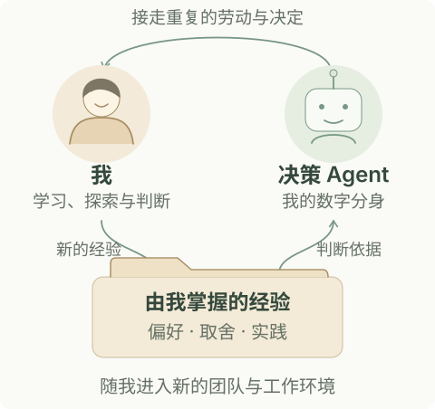
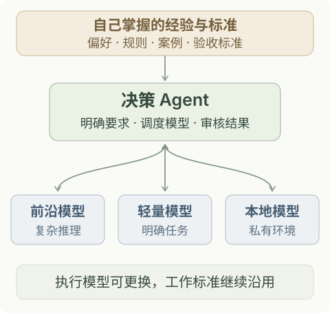

# 产品手记-决策是最重要的资产

[English](../en/architecture-evolution-decisions.md) · 简体中文 · [文章索引](../README.zh-CN.md)

> 从协作事件中积累经验，让决策 Agent 逐步承担熟悉的判断，也让个人和团队在更换模型时保有自己的工作方式。

作者：CoLand 团队\
首次发布：2026-11-14 · 原文更新：2026-11-14 · 同步日期：2026-11-14\
[官网中文原文](https://www.coland.ai/zh/articles/architecture-evolution-decisions) · 本文为官网原文的同步副本。

文章中的现状与设想以原文时间背景为准；当前支持范围见[FAQ](../../FAQ.zh-CN.md)。

上一篇讨论了 CoLand 当前阶段的工作：减少反馈搬运，把来源、成果、设备和 Agent 的关系组织起来。这能省去一部分协调动作，但任务做得对不对、某种修改是否合适，仍然需要人来判断。\
当这些判断反复发生时，我们会遇到下一个问题：**人已经解释过很多次的要求，能否沉淀下来，成为以后做决定的依据？**

这是我们下一阶段的方向。我们计划在事件与关联的基础上，让个人和团队的经验进一步参与任务安排、结果审核和日常判断。\
这一层还承担另一个目标：把长期积累的工作方式留在自己掌握的环境里。即使执行工具或底层模型发生变化，团队也有依据指导新的执行者，并检查它是否达到了原有标准。

## 从一次反馈中留下判断的来由

设想一份面向老客户的活动文案。Agent 写了「史上最大优惠」，负责人要求删掉，改成具体的优惠条件。仅保存最后一版文案，后来很难知道这次修改为什么发生。\
如果同时保留原稿、评语、修改过程和最终确认，就能看到一条更有用的经验：这批客户熟悉产品，团队希望表达准确、直接，不想用没有依据的夸张词。

这条经验也有适用范围。它涉及哪类客户、哪种场景，为什么采用这种表达，哪些情况下可能需要重新讨论，都影响下一次能否沿用。\
只记住「不要写这个词」，容易把一次修改理解成普遍禁令。把背景和理由留下，新的 Agent 才有机会理解判断背后的目的。

我们希望把这样的协作链逐步整理成规则与案例。产物是判断对象，评语记录要求，修改展示如何满足要求，后续确认则说明哪些结果被接受。人对审核者的纠正，也属于这条链的一部分。\
事件因此可以成为经验的来源，但原始记录还需要经过筛选、归纳和核对。哪些只是一次性的要求，哪些值得反复使用，不能仅凭评论出现过就自动认定。

**下一阶段要积累的，是有背景、有理由、能够被修正的判断依据。**\
它可以先表现为规则、案例和评审记录；随着验证推进，再探索怎样用于检索、评审提示或模型训练。我们关心的是经验能否帮助后续交付，具体方法需要用效果来选择。

## 让积累成为自己的资产

谈到把经验交给 AI，「蒸馏」并不总是一个让人安心的词。在与同事交流时，我们也听到过这样的顾虑：如果自己的方法和判断都被系统学会了，自己在组织里的价值会不会因此被替代？\
当这些积累只留在公司、模型服务或 Agent 平台里，个人却无法继续掌握和使用它们时，这种担心很容易理解。我们认为，决定这件事价值的一个关键，是积累下来的东西最终属于谁、为谁服务。

模型产品已经在积累对用户的长期理解：[ChatGPT 的记忆功能](https://openai.com/index/memory-and-new-controls-for-chatgpt/)会参考历史交流提供个性化回应，[Claude 也提供记忆导入与导出](https://support.claude.com/en/articles/12123587-import-and-export-your-memory-from-claude)。\
我们的判断是，这类能力会继续向人的决策方式延伸：为什么接受一种方案、什么时候改变主意、哪些要求始终不能退让，都可能成为模型厂商和 Personal Agent 平台争取的长期竞争优势。

Agent 越理解一个人，就越有机会成为他的长期工作伙伴。如果这种理解只能留在某个平台里，个人积累得越多，迁移时需要重新建立的东西也越多。\
因此，我们希望从产品设计之初，就把这份积累的归属和可迁移性放在核心位置。

**个人的判断方式、偏好和经验，应当成为由本人掌握、为本人服务、可以随本人迁移的资产。**\
它们可以逐步形成一个熟悉自己的数字分身：知道我怎样看待问题，理解我为什么接受或拒绝某种方案，也能在已有约定下替我处理重复的工作和决定。

这样，我就有更多精力去学习尚未掌握的知识，尝试新的方法，面对更有挑战的问题。新的经验又能帮助数字分身改进判断，让它承担更多熟悉的事情。\
**人继续学习和成长，Agent 随着人的经验一起成长，两者共同处理外部的事务。** 经验被整理出来之后，持续为我提供帮助，我也可以把注意力投入下一次探索。

这份资产应当能够伴随个人的职业变化。加入下一个团队、换一家公司，或者创办自己的企业时，自己积累的判断方式和工作经验仍然可以继续使用。\
它也应当能够配合不同的模型工作。更换模型供应商，或者选择本地模型、适合某个领域的模型时，这份由自己掌握的经验，可以帮助新的执行者理解自己的要求，减少重新磨合的成本。

因此，即使工作中调用了外部平台和模型，我们也希望用户能够在自己手中保留一份可继续整理、使用和迁移的经验。下一阶段的设计，会围绕这个归属展开。\
当积累的结果始终为自己服务，「蒸馏」才有了积极的意义：它让我们带着过去获得的能力，继续向前走。

我们把承接这份个人经验、代表自己参与工作判断的数字分身，称为 **「决策 Agent」**。\
在接下来的设计中，它会以我们持续整理的判断、偏好和实践经验为依据，参与任务安排、结果审核和熟悉的决定；遇到新问题，再带着背景与人共同讨论。这样，个人积累下来的经验，就有了一个持续为自己工作的载体。

## 让决策 Agent 按这些依据分工与审核

当一个人说明目标时，决策 Agent 可以结合任务要求、已有经验，以及不同执行者的能力，安排由谁做、怎样拆分、哪些工作可以并行。执行者提交结果后，它再按相应标准做第一轮审核。\
原来需要人反复完成的「把任务交下去—读结果—说明要改哪里」，其中一部分就有机会由这一层承担。

前一阶段的协作关联，在这里继续发挥作用。决策 Agent 可以在代码或文档旁留下审核意见，意见沿着已建立的关系返回原执行者。修改之后，它再查看新版本。\
人既可以看汇报，也可以回到成果上观察这轮协作：执行者交出了什么，审核者依据什么提出修改，最后为什么接受。

这种可观察的过程很重要。假如决策 Agent 把「不要夸大优惠」理解成「所有文案都只能写参数」，负责人就可以在它的评语下纠正：我们要求承诺有依据，并没有放弃有感染力的表达。\
这次纠正针对的是审核依据。它应当进入后续整理，让下一次审核更接近人的真实要求。

**人逐步从逐项审查所有产物，转向校准审核标准、处理例外和检查关键结果。**\
决策 Agent 能否稳定承担这些工作，要通过反复交付验证。减少人的审核时间，同时保持结果质量，是这一层需要同时做到的事。

## 逐步把日常决策交给 Agent

人的瓶颈既发生在结果审核，也发生在工作推进中。许多任务已经知道下一步怎么做，只是在等一个条件满足，或者等人再次说一句「可以继续」。\
如果既定条件和授权范围都明确，决策 Agent 就可以根据新事件判断，是否到了继续执行的时候。

例如，一项方案工作正在等待客户补齐资料。资料到达后，系统关联到原来的任务，决策 Agent 核对缺少的内容已经补齐，就可以让原执行者继续整理方案。人不必为了转达「资料到了」再打开一次对话。\
如果客户同时提出了超出原约定的新要求，就需要重新判断目标或范围。决策 Agent 可以把变化及其影响整理清楚，再交给负责人。

这也是我们把协作事件继续扩展到邮件、日历和其他通知的原因。前一阶段先解决消息怎样进入工作环境，下一阶段再判断哪些变化值得处理、哪些能按已有约定继续、哪些需要人介入。\
当人对新情况作出决定后，这次决定连同适用条件，可以成为下一次处理类似情况的依据。

**我们希望，人主要面对尚未形成经验的问题；已经确认的做法，则逐步由 Agent 在授权范围内承担。**\
这回应了序章关于日常决策占比的判断。信任会在一次次结果被接受、错误被纠正的过程中建立，人也可以按自己的节奏集中查看已处理事项和待决问题。

## 以决策 Agent 保持工作标准

无论是组合不同成本的模型，还是更换模型、设备和执行工具，背后都有同一个前提：**把长期积累的经验与要求保留在决策 Agent 这一层，让执行方式可以变化，工作标准继续沿用。**\
在我们的设计中，个人的偏好、判断案例、业务流程和验收标准，会保存在自己掌握的环境里，由决策 Agent 持续整理和使用。它根据这些依据说明任务要求、选择执行者，并审核交付结果。

这样，选择模型就可以围绕具体任务展开。复杂的问题可以调用更强的模型推敲方案，要求已经清楚的部分，可以交给较便宜的模型或本地模型完成。\
无论由谁执行，决策 Agent 都会带上相应的背景和约束，再按同一套要求审查结果。模型的价格与能力决定它适合承担什么，个人和团队积累的标准则决定结果是否可以接受。

更换模型或迁移工作环境时，也沿用这套方式。新执行者接到的任务，会包含已经整理过的偏好、规则与案例；决策 Agent 继续依据这些要求提出修改、核对结果，帮助它理解过去形成的工作方式。\
我们希望，用户可以保留、修订和迁移自己的经验，换一个执行工具时，也能延续已经建立的要求与流程，减少从头解释和重新磨合的成本。

**更换的是执行者，持续保留的是自己的判断依据和对结果的要求。**\
这也是我们衡量这套设计的方式：无论使用更便宜的模型，还是迁移到本地环境，都要通过实际任务核对原有标准是否得到延续，并把决策、执行与修改的完整成本一起计算。

## 在与 AI 协作中保护自己的价值

从序章的判断走到这里，CoLand 的两阶段工作可以连起来看：当前先减少人的协调负担，把复杂的工作环境和协作事件组织好；下一阶段再从这些事件中提炼经验，让一部分判断能够被委派，让经验能够随执行工具迁移。

我们会用实际任务检查这条路是否成立。相同类型的工作，负责人需要介入多少次；交付能否满足已经确认的标准；换成更便宜或私有部署的模型以后，需要重新解释和修正多少内容。\
这些结果会告诉我们，积累下来的经验是否真正可用，决策层是否确实减轻了人的负担，以及模型的组合方式是否值得继续投入。

AI 飞速发展，我们能感受到很多人的焦虑：当越来越多的工作都可以交给 AI，自己积累的经验和判断，还能怎样成为自己的价值？这种担心，也是我们做这套工具的一个重要原因。

选择这个方向，意味着我们可能与一些平台争夺同一层价值：对用户决策方式的长期理解。如果一种商业模式依赖用户把经验持续留在单一平台，我们主张的可迁移性，就可能与它的利益发生冲突。\
我们的立场是，让这份理解最终成为用户能够掌握的能力，让人在工具和模型变化时，仍然拥有选择。

这条路的难点也很具体。我们需要持续适配不同平台，把零散的反馈整理成可用的判断依据，并验证这些经验能否在更换模型后继续发挥作用。每一次接入和迁移，都需要维护与验证。\
我们希望用户愿意为更顺畅的协作、长期可用的个人积累，以及保有选择的自由付费。这样的支持，也让我们能够持续建设和维护这些能力。

**我们希望帮助每一个人尽可能充分地利用 AI、与 AI 协作，并在这个过程中保护和发展自己的价值。**\
自己的知识、经验、偏好和判断，应当继续由自己掌握，成为可以带着走、持续发展的能力。我们希望每一次与 AI 的合作，都能让人有更多空间去学习、创造，并决定自己的方向。

回到开篇 [产品手记-对未来的一些判断](architecture-evolution-prologue.md)
