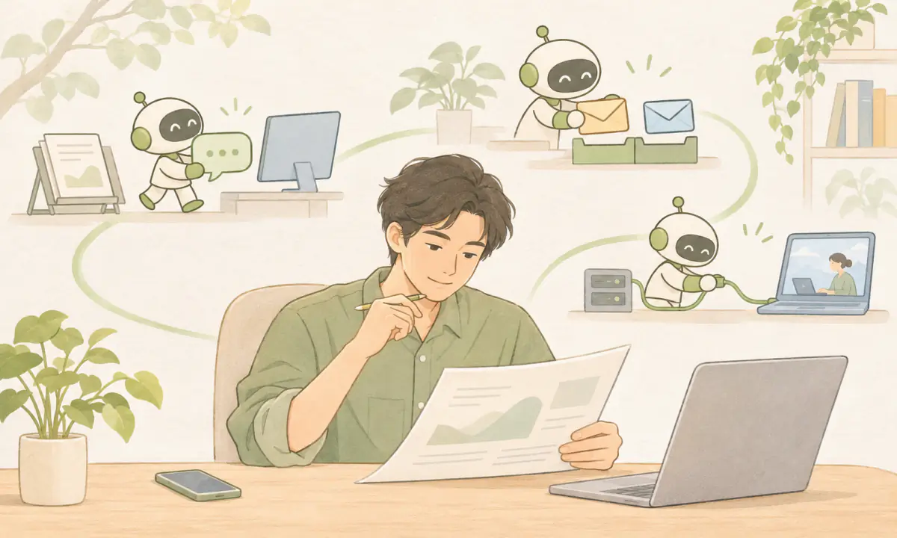
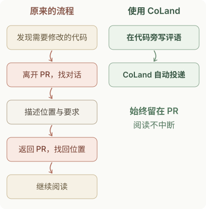
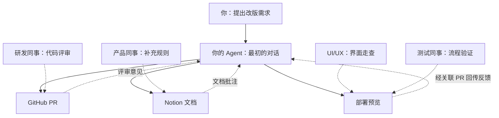
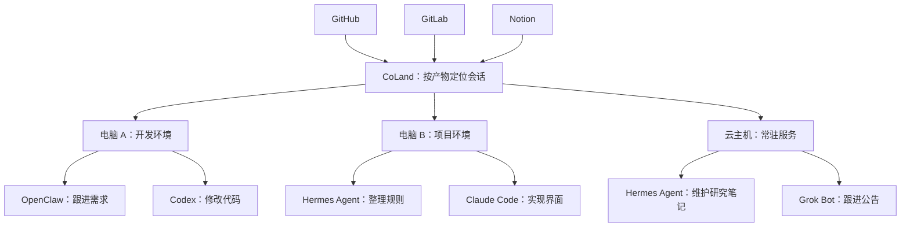
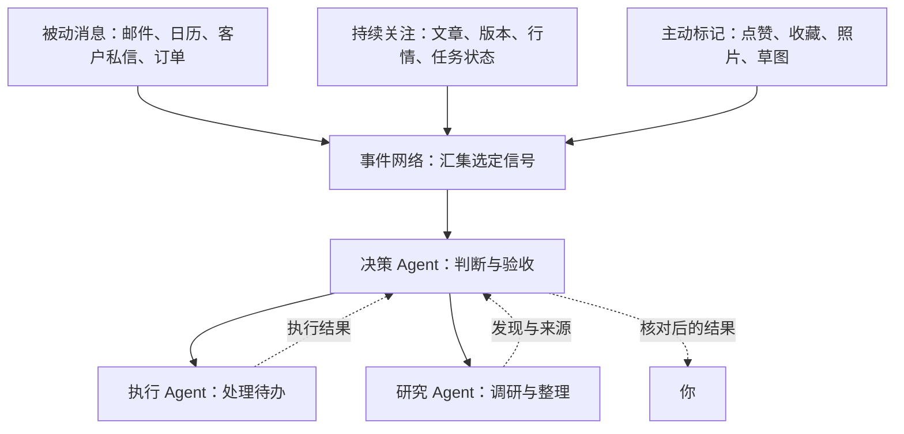

# 产品手记-把注意力还给人

[English](../en/architecture-evolution-feedback.md) · 简体中文 · [文章索引](../README.zh-CN.md)

> 减少反馈搬运与反复切换，把分散的平台、设备和 Agent 组织起来，是 CoLand 当前阶段要做的事。

作者：CoLand 团队\
首次发布：2026-11-14 · 原文更新：2026-11-14 · 同步日期：2026-11-14\
[官网中文原文](https://www.coland.ai/zh/articles/architecture-evolution-feedback) · 本文为官网原文的同步副本。

文章中的现状与设想以原文时间背景为准；当前支持范围见[FAQ](../../FAQ.zh-CN.md)。

上一篇里，我们提出了几个相互关联的判断：Agent 会承担更多工作，个人与组织的 AI 工作环境会越来越复杂，而人的时间和注意力，会成为并行规模的瓶颈。\
这决定了 CoLand 当前阶段的重点：**减少人为了让工作继续进行而付出的协调成本，让注意力更多地留在成果和重要判断上。**

这项工作有两个部分。一部分发生在协作过程中：找对话、搬运意见、补充背景、追踪处理结果。另一部分发生在工作环境里：不同平台的消息、不同设备上的 Agent，以及它们与具体任务之间的关系。\
今天我们在做的产品，就是从这两个部分开始，把原本由人记住和维持的关系，逐步交给系统。

沿着减少注意力损耗的方向，我们也在设计一个延伸：把工作之外的阅读、学习和通知组织起来，让外部信息更容易进入自己的知识与工作。这是后面会谈到的「事件网」。

## 并行工作增加，也会增加人的协调负担

一个 Agent 改代码，另一个写方案，还有一个整理资料。它们可以同时工作，但交付之后的评审意见，可能分别出现在 GitHub、文档和其他协作平台里。\
人要先判断意见针对哪项工作，再找出负责它的 Agent、当时的对话和所在的设备。即使意见已经写得很清楚，也常常需要重新整理成一段指令，才能让执行者接着做。

这些动作单独看都很小。真正的代价，是它们插在需要连续思考的工作中间。\
我正在读一份设计方案，发现一处不合理的地方。原本只需要在那一段留个评论，现在却要离开文档，打开聊天列表，辨认任务，再把意见送过去。等我回到文档，还要找回刚才读到哪里、正在考虑什么。

反馈来得越晚，这件事越麻烦。几天前写的文档，今天才有人看；同一天做过几份相似的方案，只凭对话标题未必能马上分清。任务越多，人需要记住的对应关系也越多。\
**在这些环节中，已经完成的判断仍然需要人再搬运一次。我们首先想省掉的，就是这部分工作。**

## 在看到成果的地方，把意见交下去

代码评审是一个很直接的例子。我在 GitHub 里看到一段删除共享项目的代码，发现它没有让用户确认，就在对应位置写下「删除前请让用户确认」。\
这句话已经说明了需要修改的地方。我希望写完之后继续审代码，由负责这项工作的 Agent 接着处理。

CoLand 从成果与原对话的关联做起。在已接入的流程中，Agent 创建或接手一份成果时，就登记这份成果由哪个 Agent、在哪台设备、哪段对话里负责。之后收到属于它的反馈，系统便可以按这条关系找到原来的执行位置。\
人不需要重新回答「这是谁做的」「应该打开哪个窗口」。代码位置、评论内容和对应成果一起进入原对话，Agent 可以沿用之前的背景继续工作。

原对话的价值，在于之前的讨论还在那里。我们为什么选这套实现、哪些约束已经确认、哪些方案已经放弃，都是后续修改需要的背景。\
CoLand 负责保存关联并递送反馈，执行仍由原来的 Agent 完成。它修改后，人再回到同一份 PR 或文档查看结果。反馈送达、Agent 开始处理，以及成果确实改好，是不同的进展，都需要能够分辨。

**人保留阅读、判断和验收，系统承担定位与转交。**\
这也是「让反馈回到原对话」在产品中的位置：它是我们减少注意力切换的一种实现方式。

## 多人协作不必再由一个人负责传话

同样的问题也会发生在团队里。我和 Agent 讨论出一份活动方案，交给负责人审阅。负责人关心奖品安排是否合理、预算是否合适，并不需要知道我在本地用了哪一个 Agent。\
如果他在文档里写下「奖品预算减半」，以前我要先看到这条意见，再找到原对话，把要求转述过去。我的注意力因此被打断，修改也要等我有空才会开始。

多人讨论时，搬运工作还会变成意见收集。一位同事提出修改，另一位补充背景，负责人最后确认采用哪种方案。人既要参与讨论，又要把分散的内容重新拼起来，交给执行者。\
我们希望讨论继续留在成果旁边。同一份成果的评论、回复与确认结论，按关联进入负责它的对话。执行者能看到意见的来源和位置，参与协作的人也能在原处检查后续修改。

这里仍然需要人的判断。两条意见相互冲突时，选择哪一种，往往取决于团队对目标的理解。负责人可以直接在讨论中说明结论，系统负责把结论交下去。\
**我们要减少的是收集、复制和转述意见的负担，让人的精力用在讨论本身。**

当协作对象扩展到客户、外部伙伴或开源贡献者时，这种分工也成立。外部参与者只需在熟悉的平台上表达意见，不必进入我们的 Agent 工具，也不必了解背后的执行环境。

**反馈沿着成果关联回到原对话**

[GitHub 简图；查看官网原图](https://www.coland.ai/zh/articles/architecture-evolution-feedback#多人协作不必再由一个人负责传话)

## 把分散的工作环境组织起来

随着 Agent 变多，问题会从几个聊天窗口扩展到整套工作环境。代码工作可能留在一台电脑，资料处理放在另一台设备；有些任务使用本地模型，有些调用远程服务。成果又分散在代码平台、文档系统和表格里。\
用户需要维持的不只是一个工具列表，还包括「哪个设备上的哪个 Agent，正在负责哪一项工作」。新的通知进来时，这条关系决定了它应该去哪里。

因此，CoLand 当前的建设也在围绕四类对象展开：协作来源、设备、Agent 和成果。我们希望不同来源的变化，能够以事件的形式进入同一套管理方式，再沿着成果关联找到对应的执行环境。\
一条评论来自 GitHub，另一条来自文档，它们的具体内容不同，但都需要保留来源、位置、所指向的成果，以及后续处理状态。事件把这些分散的信息串起来，减少人逐个平台查看和辨认的工作。

**跨设备与 Agent 的反馈分发示例**

[GitHub 简图；查看官网原图](https://www.coland.ai/zh/articles/architecture-evolution-feedback#把分散的工作环境组织起来)

这也解释了为什么我们一边接入更多协作平台，一边扩展 Agent 接入。只连接消息来源，仍然需要人把消息交给执行者；只连接 Agent，又不能让它自然地参与外部协作。两边的关系，需要由同一套系统维持。\
在已接入的范围内，用户可以查看连接与事件记录，知道反馈是否到达、应由哪个执行环境接收，以及是否存在需要处理的问题。这样，查进展也有了共同的入口。

当前版本已经在建设和扩展这些接入与关联能力。更多设备环境、通知来源和 Agent 的覆盖，会沿着这套方式逐步加入。我们希望最终形成的是一个可以持续扩展的工作环境：工具和设备增加时，人的管理负担不必按同样的速度增加。

## 把外部的信息也组织起来

打断注意力的事情，并不只来自工作中的协作。读到一篇值得研究的论文，我可能要离开网站，找到负责调研的 Agent，把链接和自己的问题重新交代一遍。看完一次访谈，我又需要摘出重要观点，再和 AI 讨论它们与手头工作的关系。\
这些内容有价值，但把它们变成自己能够使用的知识，往往还需要一段收集、筛选、整理和转交的过程。

**「事件网」是我们正在设计、即将上线的一部分：把外部信息与个人的知识、任务和 Agent 联系起来，让它们先经过整理，再进入人的注意力。**\
入口可以是主动分享的一篇论文、一段视频，也可以是在平台允许接入的范围内，来自收藏、邮件或其他应用的通知。我们希望用户在发现内容的地方，就能把它交给合适的 Agent，接续已有的研究或工作。

一段四五十分钟的访谈，可能只有少数观点值得我进一步研究。其余内容，有些是我已经知道的，有些是已经实践过的。仅仅生成一份按时间顺序排列的摘要，仍然需要我再筛一遍。\
我们设想的处理方式，是让 AI 结合用户已经保存的知识、讨论和实践记录，先识别重复的部分，再留下新增的认识、与原有判断不同的观点，以及尚待验证的做法。相关的出处与关键片段也应保留，方便人继续追问和回看。

整理后的内容，还可以适应个人的学习方式。一个结构复杂的观点，可以用图表展开；一套值得学习的方法，可以整理成演示材料；几种做法之间的区别，也可以用对照图帮助理解。\
用户拿到的，是更适合自己消化和讨论的材料。我们的目标，是把原本需要长时间观看和筛选的过程，缩短为一次围绕新增内容的集中阅读。

收藏也可以成为后续学习的起点。在能够接入收藏等信号的平台上，一个动作可以触发后台分析：这段内容讲了什么，与我正在做的哪件事有关，是否提供了值得尝试的改进。\
例如，看到一种新的用户访谈方法后，AI 可以联系到正在进行的调研，整理它与已有做法的差异，提出一次小范围实践的建议。用户经过讨论和实践，再决定哪些内容值得纳入自己的知识库。外部信息就有机会进入实际工作，而不只是停在收藏列表里。

邮件和日常提醒也可以用同样的方式处理。AI 先判断一条消息与哪项任务有关：能够按已有约定和授权交办的，交给对应的执行者；需要新的判断的，整理好背景和影响，再交给人。\
这一设计会与下一阶段的决策能力配合，逐步减少只为查看、辨认和转达消息而发生的切换。

**事件网设想：组织选定的信号，再安排处理**

[GitHub 简图；查看官网原图](https://www.coland.ai/zh/articles/architecture-evolution-feedback#把外部的信息也组织起来)

**我们希望把人的注意力更多地留给未知、分歧和实践，让重复的信息筛选与转交由系统承担。**\
工作内的协作反馈与工作外的阅读、学习、通知，都在影响同一份有限的注意力。「事件网」要探索的，就是如何把这些外部影响也组织起来。

## 先让协作运转，再让判断沉淀

这一阶段，我们从减少反馈搬运和反复切换做起：让意见在成果旁边交下去，让多人协作不必经过一个人传话，再把分散的平台、设备和 Agent 组织起来。这些办法都在减少人为了协调工作而付出的精力，让阅读和思考更连贯。

工作之外的阅读、学习和各种通知，也在不断分散我们的注意力。「事件网」会沿着这个方向继续探索。但把信息收集起来之后，哪些值得关注、哪些可以沿用已有经验处理、哪些需要人重新判断，仍然需要更了解我们的 Agent 来帮助分辨。

因此，下一步还要研究如何让决策 Agent 更好地理解我们的要求，逐步承担熟悉的判断，把值得学习和讨论的新问题交回来。**把有限的注意力集中在新的、重要的事情上，是这些设计共同的目标。**

下一篇 [产品手记-决策是最重要的资产](architecture-evolution-decisions.md)，我们会继续讨论：协作中留下的经验如何成为决策的依据，以及这些积累如何由自己掌握、持续为自己服务。
