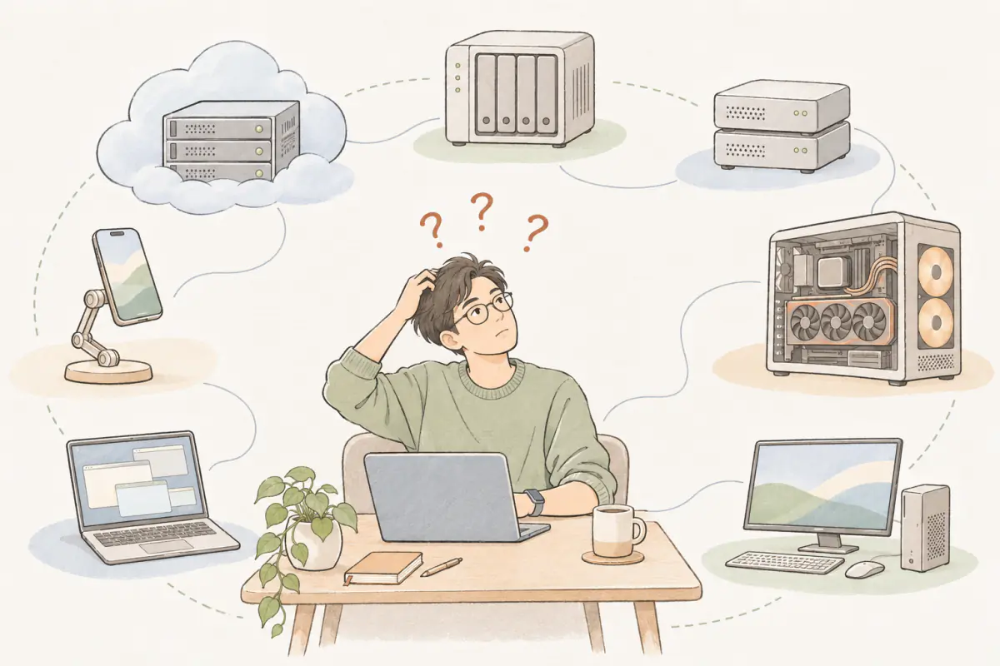
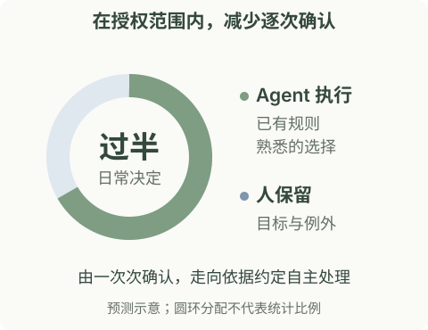
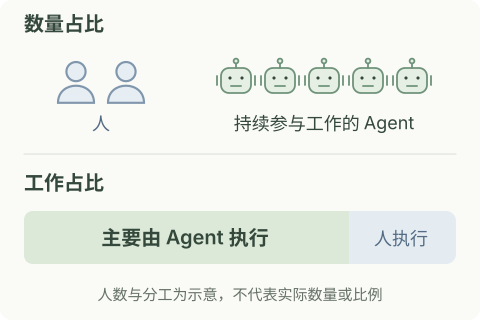
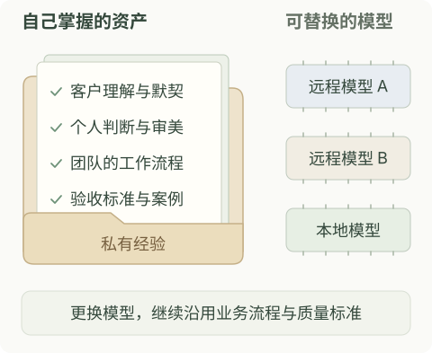

# 产品手记-对未来的一些判断

[English](../en/architecture-evolution-prologue.md) · 简体中文 · [文章索引](../README.zh-CN.md)

> 以终为始：从对未来的判断出发，定义产品的长期目标。

作者：CoLand 团队\
首次发布：2026-11-14 · 原文更新：2026-11-14 · 同步日期：2026-11-14\
[官网中文原文](https://www.coland.ai/zh/articles/architecture-evolution-prologue) · 本文为官网原文的同步副本。

文章中的现状与设想以原文时间背景为准；当前支持范围见[FAQ](../../FAQ.zh-CN.md)。

做产品，可以从眼前已经发生的需求出发，把一个具体问题解决好。也可以把目光放远，先判断行业会往哪里走，再推演那时人们会遇到什么问题、需要什么工具。\
CoLand 选择的是后一条路。

站在今天，它的能力还比较薄，也很难指向一个庞大的用户群体，或一个所有人都迫切想解决的痛点。我们愿意持续投入，是因为我们判断，当模型、Agent 和工作方式继续变化时，有些需求会逐渐变得重要。这个系列记录的，就是这些判断，以及我们据此设计产品的思路。\
本篇提出的是一组面向明年此时，也就是 2027 年 11 月的假设：那时会出现什么变化，人们会遇到什么问题。我们希望围绕这些较长期的假设，规划产品和功能；后续文章再展开具体设计。

## 能力最强的模型会更贵

2025 年 11 月，Anthropic 发布 Opus 4.5，标准 API 每百万输入和输出 token 分别收费 5 美元、25 美元。2026 年 11 月，它推出面向更难任务的 Fable 5.2，价格分别为 8 美元、40 美元。以相同计价单位比较，这两代前沿选择的输入、输出价格都提高了 60%。\
与此同时，Fable 5.2 的价格又低于同一产品线的上一代 5.1。厂商在降低已有能力的使用成本，也在为更高的能力设立新的价格档。[Opus 4.5 发布说明](https://www.anthropic.com/news/claude-opus-4-5) · [Fable 5.2 价格与评测](https://www.anthropic.com/claude-fable-and-mythos-5-2)

提供这些能力需要的基础设施投入，也在快速增加。Anthropic 披露，2026 年前九个月的算力和基础设施支出为 188.08 亿美元，上年同期为 43.81 亿美元。美光在 2026 财年第四季度的业绩说明中披露，DRAM 价格环比上涨接近两成，并预计 2027、2028 年内存与存储的供需会更加紧张。模型规模、上下文长度和并发量的增长，也在推高所需的内存容量。[Anthropic 注册文件](https://www.sec.gov/Archives/edgar/data/2130357/000162828026072484/anthropicpbc-sx1ax2.htm) · [美光业绩说明](https://s25.q4cdn.com/621799436/files/doc_financials/2026/q4/Q4-FY26-Prepared-Remarks.pdf)

电力也有类似的压力。美国能源信息署的数据显示，2026 年 8 月美国商业用电均价同比上涨 4.3%。国际能源署则指出，数据中心正在争夺电力、并网容量和芯片供应，更复杂的推理与 Agent 任务还会增加单次任务的能耗。\
电价、内存价格和公司总投入，最终怎样反映到模型定价上，取决于效率提升、供应合同和市场竞争。我们据此判断，持续提供最前沿能力所需的成本压力仍会很大。[美国商业用电数据](https://www.eia.gov/electricity/monthly/update/end-use.php) · [国际能源署对 AI 能源与供应瓶颈的分析](https://www.iea.org/reports/key-questions-on-energy-and-ai/executive-summary)

如果只是让 AI 把一份会议记录整理成清楚的摘要，我们也会有越来越便宜的选择。斯坦福 AI Index 记录，2022 年 11 月至 2024 年 10 月，达到 GPT-3.5 同等评测水平的推理成本降到了原来的 1/280 以下。这说明，随着技术和部署效率改进，已经达到的能力可以逐渐普及。[斯坦福 AI Index](https://hai.stanford.edu/ai-index/2025-ai-index-report)\
**我们的判断是，达到今天同样的输出质量会更便宜，而持续使用届时能力最强的模型，可能需要更高的预算。**\
当这些模型被用来长时间执行任务、同时承担更多工作时，使用者会更认真地考虑，每一份成本究竟换来了多少有效产出。

## 私有化部署的需求会从企业扩展到重度个人用户

企业一直有私有化需求。客户资料、内部知识、业务流程，以及长期积累的经验和判断标准，都是企业希望自己掌握的资产。\
企业还需要保护客户数据和业务隐私。使用外部模型服务时，哪些数据可以传出去、在哪里处理和保存、谁有权访问，都会影响企业的选择。\
这些顾虑，让企业有理由将一部分数据和处理过程留在自己的环境中。当前沿模型的使用成本继续提高，企业也更有动力评估，哪些任务值得调用最强模型，哪些可以交给自己部署的模型。

开放权重模型也在降低部署门槛。例如，gpt-oss-20b 可以在 16 GB 内存的设备上运行。选择是否自建时，可以把设备、维护和实际使用量一起算进去，比较完成同类任务的总成本。[开放权重模型的运行要求](https://openai.com/index/introducing-gpt-oss/)

我们观察到，一些重度个人用户也在搭建自己的 AI 工作环境。从为 OpenClaw 单独准备一台设备开始，有人继续接入手机、控制移动设备的硬件、闲置电脑和 NAS，逐步丰富自己的工具库、组件库与设备库。\
这种多设备协作已经有了软件基础。例如，OpenClaw 支持把 macOS、iOS、Android 等设备作为节点接入，让 Agent 使用不同设备提供的能力。[OpenClaw 的设备节点](https://docs.openclaw.ai/nodes)

本地算力也有了更多选择。NVIDIA DGX Spark 提供 128 GB 统一内存配置，并支持两台设备直连；Mac Studio 则提供 256 GB、512 GB 统一内存配置。个人可以用这类设备搭建本地模型环境，再与存储、移动设备和远程服务组合使用。[DGX Spark](https://www.nvidia.com/en-us/products/workstations/dgx-spark/) · [Mac Studio 配置](https://www.apple.com/mac-studio/specs/)\
在这些重度用户身上，我们看到的是一个逐渐复杂的个人 AI 工作环境，需要管理的已经包括模型、Agent、设备，以及它们之间的协作方式。

熟悉不同 Agent 的人，也会积累自己的工作流、Skills、专业资料和使用偏好。Hermes Agent 已经提供自行部署、接入不同模型、积累技能和长期记忆的能力，让这些经验能够留在个人维护的环境里。[Hermes Agent 项目](https://github.com/NousResearch/hermes-agent)\
当这些内容与设备、算力、存储结合起来，个人就拥有了一套跨设备、跨操作系统，连接本地与云端的 AI 工作环境。\
怎样组织这套生态，让 Agent 找到合适的设备、调用需要的工具、使用必要的资料，并让整个环境高效运转，会成为新的问题。资产的保护、维护与迁移，也需要放到这套环境中一起考虑。

私有化可以从一部分工作开始。把知识与规则留在自己控制的环境里，需要作复杂判断时，将允许外发的背景交给远程前沿模型。方案明确后，再让本地模型完成适合它的执行任务。微软的开发文档也把本地与云端结合使用列为一种部署方式。[微软的混合部署说明](https://learn.microsoft.com/en-us/windows/ai/cloud-ai)

**我们预计，私有化部署的需求会同时来自企业和重度个人用户，本地与远程模型组合使用会更加普遍。**\
由自己掌握工作资料和 Agent 环境，也让以后更换模型、调整成本和重新分配任务有了基础。

## 人是多 Agent 并行工作的瓶颈

花钱订阅了更强的模型，或者投入设备部署了自己的模型，人自然希望它们多做一些有用的工作。但买到更多执行能力以后，我们可能发现，最难增加的资源是自己的时间。\
Agent 可以并行写代码、整理资料、起草方案，人却要逐份审核结果，在关键选择上想清楚方案是否合理，再把意见交回去。一个人能开多少个任务，和他能认真处理多少份结果，之间会出现差距。

实际使用时，这个限制往往从任务开始前就出现了。我们可以定义很多 Agent，但让谁做什么、先做哪一步、什么时候开始，仍然需要人逐个安排和唤起。\
比如，一个 Agent 负责改代码，另一个负责整理文档。即使两者已经配置好，人也可能要先交代代码任务，再打开另一个对话说明文档要求。配置的 Agent 数量可以很多，真正同时工作的数量，却受限于人能安排和跟进多少件事。

DeepSeek 的 Super-agent 设计文档，把尽量少占用人的注意力、尽量多交付价值作为核心原则，并要求逐项衡量消息、通知和提问消耗了多少人的注意力。这与我们的观察一致。Agent 变多以后，每次等待人回答、每次让人切换工作，都可能拖住一批并行任务。[DeepSeek Super-agent 设计原则](https://github.com/deepseek-ai/dsh-superagent-prototype/blob/main/docs/000-philosophy.md)

Anthropic 对 Claude Code 的研究也发现，在最复杂的任务上，Agent 主动请求澄清的频率，超过人主动打断它的两倍。执行能力增加，并不会自动消除这些需要人判断的环节。[Anthropic 对 Agent 自主工作的研究](https://www.anthropic.com/research/measuring-agent-autonomy)\
**我们预计，当更多 Agent 同时工作时，人的审核、决策和专注时间会成为限制并行规模的主要因素。**\
从同时配合 3 个 Agent，到调度 30 个、300 个，需要解决的会越来越多地落在人这一侧。怎样减少重复交代、集中处理反馈，让人把连续的注意力用在重要判断上，会成为一种越来越实际的需求。

## Agent 会替个人做出过半的日常决定

要缓解人的瓶颈，一部分原本等待确认的决定，也需要逐渐交给 Agent。最容易先放手的，是那些我已经作过很多次、每次选择都相同的决定。\
用 Codex 做完一轮任务，输入框有时会预填我下一步可能想提的要求。有些建议正好顺着我原来的思路。比如，改完一处逻辑，下一步自然是补上对应的测试。今天我还要看一眼、按下发送。\
如果它连续许多次都猜对，我就有理由把这一步交给它。下次再改代码，它可以直接补测试，我也可以少确认一轮。

Anthropic 在内部的 Claude Code 使用记录里看到了类似的变化。从 2025 年 8 月到 12 月，每次会话平均需要人介入的次数从 5.4 次降到 3.3 次。一次介入可能是补充信息，也可能是纠正一次操作。\
这个数字告诉我们，至少在这批编程任务里，使用者已经可以把更长的一段工作交给 Agent。[Anthropic 的 Agent 自主性研究](https://www.anthropic.com/research/measuring-agent-autonomy)

买常用耗材时接受多大差价，一笔报销是否符合已定标准，一份 PR 缺测试要不要退回，这些日常决定都有可复用的先例。\
**我预计，到明年这个时候，对日常使用 AI 的个人来说，一天里可记录的购买、审批、评审等决定，可能有一半以上会由 Agent 在授权范围内直接作出。完成同类目标所需的人机对话轮次也会减少。**\
这可以分别核对。如果 Agent 提了建议、最后是我按下同意，这次记作我决定。如果它依据我以前定的规则直接处理，这次才记作它决定。同一件事调用了几次工具，都只算一个决定。

## Agent 在团队中的数量和工作占比都会明显超过人

当个人能把更长的一段工作和更多日常决定交出去，团队也就有条件让更多 Agent 持续参与业务。微软《2026 工作趋势指数》显示，2025 年 3 月至 2026 年 3 月，Microsoft 365 生态内的月活跃 Agent 数量增至上年同期的 15 倍。这反映了一个平台上的增长，也让我们看到，团队正在为更多工作配置 Agent。[微软工作趋势报告及统计口径](https://www.microsoft.com/en-us/worklab/work-trend-index/agents-human-agency-and-the-opportunity-for-every-organization)

大厂也在把 Agent 带进已有的工作环境。微软在 Microsoft 365 Copilot 中提供 Researcher、Analyst 等 Agent，腾讯则推出了 WorkBuddy 及其企业版。使用者可以从现成的办公工具开始，把研究、分析和日常交付逐步交给 Agent。[微软的研究与分析 Agent](https://www.microsoft.com/en-us/copilot/blog/2025/03/25/introducing-researcher-and-analyst-in-microsoft-365-copilot/) · [腾讯的办公 Agent 产品](https://www.tencent.com/en-us/articles/2202350.html)

另一个变化来自开源项目。Hermes Agent 提供工具、技能、记忆和多模型接入，DeepSeek 也公开了 Super-agent 研究原型。开发者可以在这些基础上接入自己的业务工具、配置岗位职责，再做成适合团队使用的客户端。\
在模型之外，能够保存上下文、调用工具、管理任务并接收反馈的运行框架也在成熟。这降低了定制 Agent 的门槛，让它们有机会进入更多具体的工作流程。[Hermes Agent](https://github.com/NousResearch/hermes-agent) · [DeepSeek Super-agent 原型](https://github.com/deepseek-ai/dsh-superagent-prototype)

一个用于代码开发的 Agent，可以长期负责某个仓库里的修改。一个连接文档系统的 Agent，可以承担资料整理和方案初稿。随着能力、工具和运行框架一起改进，团队能稳定委派的工作范围也会扩大。\
我们因此预期，在较早把 AI 用入日常业务的组织里，每人配有自己的 Agent 会逐渐成为基础条件。随后，一个人会按不同职责配置多个 Agent，团队也会有共同使用的 Agent。\
**到明年这个时候，在这些组织中，Agent 在实际工作参与者中的数量占比，以及由它们承担主要执行工作的任务占比，都可能明显超过人。**\
这两个占比分别看两件事：持续参与工作的 Agent 与人各有多少，以及主要由 Agent 执行的任务与主要由人执行的任务各占多少。前者不把闲置配置算进去，后者看实际交付，不能仅凭安装数量判断。

## 独特的判断会成为个人和组织可迁移的资产

如果一个组织里，大多数执行者已经是 Agent，只有少数人参与，人和组织的价值会体现在哪里？\
同一个模型可以替不同的人设计同一款产品的介绍页面，但怎样的结果能让每个人满意，取决于他们各自的判断。

工程师希望把能力边界、技术细节和使用限制讲清楚。\
负责广告投放的人，希望首屏让目标客户立刻理解产品的用处。\
负责运营增长的人，则会结合用户反馈，判断先展示哪个场景、在哪一步引导试用。\
模型可以实现这些不同的方案。选择哪种方案、怎样取舍，以及为什么某种做法适合这批客户，来自人的经验、审美和对业务的理解。

其中一些经验，存在于长期合作形成的默契里。一个客户不喜欢夸张的承诺，一类用户对某种表达容易误解，一支团队试过某条技术路线以后，知道在什么条件下不该再用。这样的判断，很难仅从公开资料中获得。\
我们反复告诉 Agent「不要这样写」「不要省掉这一步」时，也在逐渐表达自己对客户、团队和结果的要求。这些「不要」背后的原因，以及它们适用的场景，值得和最后的产物一起留下。

这种差异值得刻意积累。在一项短篇故事写作实验里，获得 AI 创意建议的作者写出的故事，平均得到了更高的创造力评价，作品之间也更相似。\
这项实验让我们想到，当大家使用相近的模型时，各自的判断会更加重要。同样一份需求，有人先画交互，有人先验证技术路线，有人坚持去看客户怎样工作。尝试过哪些方案、为什么舍弃一个看起来不错的选项，往往比最终选了哪张稿更能说明一个人的品位和判断。[Doshi 与 Hauser 的短篇写作实验](https://pmc.ncbi.nlm.nih.gov/articles/PMC11244532/)

这些默契需要在合作和反馈中逐步形成。把几条偏好复制给新模型，并不意味着它已经理解了这个人或这批客户。保留当时的背景、尝试过的方案、反馈和取舍理由，再用后续交付检验，才有机会让经验继续发挥作用。

对企业来说，还需要把这种积累落到整套业务流程里。成本、权限或产品策略发生变化时，企业可能要更换模型，或把一部分工作迁到本地。任务怎样分配、哪些结果可以验收、客户有哪些约定，都需要由企业自己掌握。\
迁移的目标，是换了底层模型以后，业务流程仍能运转，交付仍能达到原来的质量标准。为此，工作规则、客户背景、验收依据和典型案例都应当能够带走，并用实际任务检验新模型的表现。

**我们预计，独特的判断、私有经验，以及能够随模型迁移的工作流程，会成为个人和组织更重要的资产。**\
当 Agent 承担了大部分执行工作，人积累下来的这些差异，决定了它们最终为谁服务、遵循什么标准，以及交出怎样的结果。

## 从这些判断出发设计 CoLand

这些观察，是我们考虑 CoLand 产品方向的依据。模型成本、私有部署和 Agent 数量的变化，会影响人怎样组织工作，也会带来新的协调与管理需求。\
接下来的两篇会介绍 CoLand 的两个阶段：当前怎样减少人的协调负担、组织复杂的 Agent 工作环境；下一阶段怎样从协作事件中积累判断，让决策逐步被委派，让经验能够随模型迁移。

我们也会在三个月、六个月后回看这些判断，结合新的行业变化，检查产品方向是否需要调整。

下一篇 [产品手记-把注意力还给人](architecture-evolution-feedback.md)
